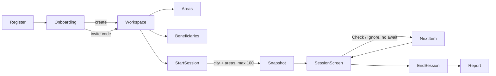

---
aliases:
  - Be My Hand Progress
  - BMH Progress
tags:
  - be-my-hand
  - progress
status: code-complete-awaiting-device-and-live-tests
current_milestone: M7
updated: 2026-11-16
cssclasses:
  - wide-page
progress %:
---

# Be My Hand: app progress

> [!summary] Helping hands, organized
> Multi-workspace field app for charities: beneficiaries, cities and areas, and one-operator distribution sessions. Arabic-first (RTL), English-ready, offline-first, Firebase **Spark (free)** only.
> Source spec: [[../be-my-hand-master-prompt|Master prompt]]. Starter: [[../templates/expo-firebase-starter/README|Expo Firebase starter]].

> [!warning] Testing honesty
> A box is ticked only when the item was built **and** checked. Every test entry says where it ran:
> - `unit`: Vitest in Node (`pnpm test`), Firebase mocked where needed
> - `emulator`: Firestore Emulator with the real `firestore.rules` (`pnpm test:rules`)
> - `device`: a dev build on a phone or simulator
> - `live`: a real Firebase project
>
> **Nothing has run on a device or against a live Firebase project yet.** Firebase config files have not been provided, so no dev build has been made.

## Status at a glance

| Milestone | State | Where checked | Docs |
|---|---|---|---|
| [[#M0 Discovery and design ^m0\|M0]] Discovery | done | review | [[docs/mafrash-reuse-report]], [[docs/firestore-schema]], [[docs/security]] |
| [[#M1 Foundation ^m1\|M1]] Foundation | done | unit, typecheck | [[docs/architecture]], [[docs/offline-sync]] |
| [[#M2 Auth and workspaces ^m2\|M2]] Auth and workspaces | done | unit, emulator | [[docs/product-flows]] |
| [[#M3 Cities, areas, beneficiaries ^m3\|M3]] Beneficiaries | done | unit, emulator | [[docs/firestore-schema]] |
| [[#M4 Locations and calling ^m4\|M4]] Locations and calling | done | unit | [[docs/product-flows]] |
| [[#M5 Sessions ^m5\|M5]] Sessions | done | unit, emulator | [[docs/session-workflow]] |
| [[#M6 History, assistance, import, export ^m6\|M6]] History, import, export | done | unit, emulator | [[docs/import-export]] |
| [[#M7 Security, testing, polish ^m7\|M7]] Hardening | done in code; device + live pending | unit, emulator | [[docs/security]], [[docs/architecture#Read and write budget]] |

**Latest run (2026-11-16):** `typecheck` clean, `lint` clean, **78 unit tests** in 11 files passing, **52 emulator rules tests** in 3 files passing.

## Flow

## Phase 1: starter template

- [x] Mafrash audit and `TEMPLATE_NOTES.md`
- [x] Config scaffold (Expo 57, TS strict, `app.config.ts`, EAS, emulator config)
- [x] Core: native Firebase client, email auth, i18next `ar`/`en` + RTL, theme tokens, UI kit, toast
- [x] Checks: `typecheck`, `lint`, `unit` (3 tests), `emulator` rules (4 tests) all passing

## Phase 2: app setup

- [x] Copied template into `be-my-hand/`, identity set (`com.salihcodev.bemyhand`, `.dev` for development)
- [x] Firebase dev/prod config placeholders (`firebase/dev`, `firebase/prod`, gitignored)
- [ ] Real `google-services.json` / `GoogleService-Info.plist` added (waiting for the developer)

## M0 Discovery and design ^m0

- [x] [[docs/mafrash-reuse-report]]
- [x] [[docs/firestore-schema]] with indexes and denormalizations
- [x] [[docs/security]] with the permission matrix (`src/services/permissions/matrix.ts`)
- [x] `firestore.rules` and `firestore.indexes.json`
- [x] [[docs/open-product-decisions]]
- [x] Firebase setup guide in `README.md`

## M1 Foundation ^m1

- [x] Dependencies added with reasons ([[docs/architecture#Dependencies and why]])
- [x] Connectivity (NetInfo) and sync status (`onSnapshotsInSync`, `waitForPendingWrites`, in-flight batch count)
- [x] MMKV outbox with backoff, idempotency, flush on launch / foreground / reconnect (`unit`)
- [x] Navigation shell, tabs, `AppHeader` with the global sync pill and sync sheet

## M2 Auth and workspaces ^m2

- [x] Register, login, logout, reset (queued offline), persistent auth, route guards
- [x] Onboarding: create workspace or join by invite link/code
- [x] Workspace creation batch (workspace + owner member + counters) (`emulator`)
- [x] Switcher (`collectionGroup('members')`), last workspace on device and profile (`unit`)
- [x] Invites: 28-char code, `get` only, single use, expiry, online only (`unit`, `emulator`)
- [x] Members: edit role/permissions, disable, remove, leave; ownership transfer (`emulator`)
- [x] `can()` layer and `useCan()`; rules mirror the matrix (`emulator`)
- [x] Audit log screen

## M3 Cities, areas, beneficiaries ^m3

- [x] Cities and areas, soft archive/deactivate, counters with `increment()` in the same batch (`emulator`)
- [x] Online renames with fan-out, admin recount
- [x] One beneficiary form (global and area), edit, archive/restore
- [x] Phones: Arabic digits, `EG` region, E.164, exactly one primary, duplicate warning (`unit`)
- [x] `nameSearch` prefix search and exact phone search (`unit`, `emulator`)
- [x] Global and area lists (FlashList, live first page + cursor pages of 20) (`emulator` for the query)
- [x] Details screen with history, assistance, pins

## M4 Locations and calling ^m4

- [x] Residential address and pickup location fields
- [x] Pins (max 10): Maps link / `lat,lng` parsing, current location (`unit`, `emulator` for the limit)
- [x] Open pin in Google Maps (`unit` for the URL)
- [x] Quick call with `call_initiated` history (never "connected")

## M5 Sessions ^m5

- [x] Setup: one city, multiple areas, `limit(101)`, block above 100, no duplicates (`unit`)
- [x] Snapshot batch (online only, item id = beneficiary id) (`emulator`)
- [x] Runner: Check ("تم") / Ignore / reopen / note without awaiting the server (`unit` with simulated offline SDK, `emulator`)
- [x] Progress, end session (counts from items), session report export
- [x] Operator reassignment (`emulator`)
- [x] Prefetch of live beneficiary docs so "View details" opens offline
- [ ] Offline behaviour verified on a device in airplane mode (`device` pending)

## M6 History, assistance, import, export ^m6

- [x] Beneficiary history, session events, audit log, all append-only (`emulator`)
- [x] Assistance records; only confirmed ones set `lastConfirmedAssistanceAt` (`emulator`)
- [x] Excel/CSV import: mapping, preview, validation, duplicates, ≤200-row / ≤490-write batches, re-run safe (`unit`, `emulator`)
- [x] Export: one `ExportDoc` model; xlsx (RTL sheet), PDF (RTL, embedded Arabic font), CSV with BOM; list / profile / session presets (`unit`)
- [ ] PDF and share sheet checked on a device (`device` pending)

## M7 Security, testing, polish ^m7

- [x] Rules emulator suite: isolation, RBAC, invites, owner, operator, transitions, snapshots frozen, append-only, import permissions (52 tests)
- [x] Unit tests for domain logic, outbox, offline runner, import, export (78 tests)
- [x] Read/write budget review ([[docs/architecture#Read and write budget]]); every query matched to an index
- [x] Accessibility pass: roles/labels on pressables, sheet backdrop as a separate close control (sheet content stays reachable by screen readers), 44pt minimum touch targets
- [x] RTL pass: no physical left/right styles; phones and codes wrapped LTR
- [x] Docs final: README, architecture, product flows, offline-sync (with known limitations), import-export
- [ ] Device run (Android + iOS dev builds)
- [ ] Live Firebase run (deploy rules/indexes, smoke test each flow)

## Required tests (master prompt section 25)

| # | Test | Where | State | Test file |
|---|---|---|---|---|
| 1 | Register and create a workspace | emulator (workspace batch); register UI needs device | partial | `tests/rules/workspaces.test.ts` "workspace bootstrap" |
| 2 | Switch between workspaces | unit | passing | `tests/workspace.test.ts` |
| 3 | Workspace data is isolated | emulator | passing | `tests/rules/beneficiaries.test.ts` "workspace data is isolated", `workspaces.test.ts` "workspace access" |
| 4 | Member cannot do unauthorized operations | emulator | passing | all three rules files |
| 5 | Invite single-use, expires, no unissued role | unit + emulator | passing | `tests/invite.test.ts`, `workspaces.test.ts` "invites" |
| 6 | Multiple phones, one primary, Egypt + Arabic digits | unit + emulator | passing | `tests/phone-search.test.ts`, `tests/beneficiary.test.ts` |
| 7 | Multiple pins, correct Maps URL | unit + emulator | passing | `tests/maps.test.ts`, `beneficiaries.test.ts` "max 10 phones and pins" |
| 8 | Cursor pagination, Arabic search normalization | unit + emulator | passing | `phone-search.test.ts`, `beneficiaries.test.ts` "lists paginate by cursor" |
| 9 | Session picks correct beneficiaries, no duplicates, cap 100 | unit + emulator | passing | `tests/session.test.ts`, `sessions.test.ts` "≤100" |
| 10 | Check / Ignore advance, work offline, sync later | unit (simulated offline SDK); device pending | passing in unit | `tests/session-offline.test.ts` |
| 11 | Only operator processes; no double processing | emulator | passing | `sessions.test.ts` "session runner" |
| 12 | Session events recorded; ending preserves history | emulator | passing | `sessions.test.ts` "ends once" |
| 13 | Profile changes do not rewrite snapshots | unit + emulator | passing | `session-offline.test.ts`, `sessions.test.ts` "snapshot fields are frozen" |
| 14 | Check does not create assistance or change `lastConfirmedAssistanceAt` | unit + emulator | passing | `session-offline.test.ts`, `sessions.test.ts` "Check never confirms assistance" |
| 15 | History / events / audit append-only | emulator | passing | `beneficiaries.test.ts` "history", `workspaces.test.ts` "audit log", `sessions.test.ts` |
| 16 | Import validation and duplicate detection | unit + emulator | passing | `tests/import.test.ts`, `beneficiaries.test.ts` "import and export" |
| 17 | CSV Arabic in Excel; xlsx and PDF Arabic | unit (BOM, SheetJS round trip, RTL HTML + embedded font); device pending for the PDF | partial | `tests/export.test.ts`, `tests/import.test.ts` |
| 18 | Outbox retries and idempotency | unit | passing | `tests/outbox.test.ts` |

## Manual checks before release (device + live)

- [ ] Register, create workspace, invite a second account, join by link, switch workspaces
- [ ] Airplane mode: add/edit beneficiary, run a session (Check / Ignore / reopen / note / end), then reconnect and confirm everything syncs and the pill returns to "synced"
- [ ] Import a real Excel file with Arabic headers; re-import it and confirm nothing is duplicated
- [ ] Export xlsx, CSV and PDF; open each in Excel / Google Sheets / a PDF viewer and confirm Arabic and RTL
- [ ] TalkBack and VoiceOver across the main screens
- [ ] Deploy `firestore.rules` and `firestore.indexes.json` to both projects; watch the console for missing-index errors

## Risks

> [!warning] Known risks
> - **Offline acknowledgement:** offline Firestore writes resolve only after the server confirms. Every field action is fire-and-forget with sync state shown separately.
> - **Invites without Functions:** security depends on `get`/`getAfter` rule checks in a single batch; covered by emulator tests.
> - **Batch size:** a session snapshot is at most 100 items plus a few docs; imports are chunked to ≤490 writes.
> - **Counter drift:** counters are display only; an admin "recount" action repairs them.
> - **Search:** prefix only on normalized names, exact phone match. No substring or full-text search.
> - **iOS distribution:** needs a paid Apple Developer account (outside the free tier).
> - **Background sync:** not relied on. Sync runs while the app is open.
> - Full list of limitations: [[docs/offline-sync#Known limitations]].

## Decisions

> [!info] Decided in v1 (changeable)
> Check means processed only. Sessions persist and resume. One operator per session; admins reassign. Ignored items stay ignored unless reopened. Multiple assistance types per session allowed. One area per beneficiary. Pins are general locations with labels. History gated by `history_view`. Per-field last-write-wins with history.
> Full list: [[docs/open-product-decisions]].

## Open items for the developer

- Confirm the bundle id / package `com.salihcodev.bemyhand` (dev: `com.salihcodev.bemyhand.dev`).
- Add the Firebase config files to `firebase/dev/` and `firebase/prod/`, then build the dev client (`pnpm android` / `pnpm ios`).
- Deploy rules and indexes (`pnpm deploy:rules`) to both projects.

## Log

- **2026-11-16**: Starter template extracted from Mafrash and verified (`typecheck`, `lint`, `unit`, `emulator`). Be My Hand created from it.
- **2026-11-16**: M0–M4 built: docs, rules, indexes, foundation, auth, workspaces, members, invites, places, beneficiaries, phones, search, pins, calling.
- **2026-11-16**: M5 sessions (setup, snapshot, runner, end, reassign) and home dashboard.
- **2026-11-16**: M6 assistance, history, Excel/CSV import, xlsx/PDF/CSV export.
- **2026-11-16**: M7 hardening: required tests mapped and filled (78 unit, 52 emulator), session prefetch, accessibility and touch targets, budget review, final docs. Device and live Firebase runs still pending.
