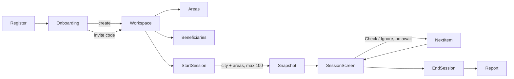

---
aliases:
  - Be My Hand Progress
  - BMH Progress
tags:
  - be-my-hand
  - progress
status: refactor-v5-v7-done-in-code
current_milestone: V7
updated: 2026-11-23
cssclasses:
  - wide-page
progress %:
---

# Be My Hand: app progress

> [!summary] Helping hands, organized
> Multi-workspace field app for charities: beneficiaries, cities and areas, and one-operator distribution sessions. Arabic-first (RTL), English-ready, offline-first, Firebase **Spark (free)** only.
> Source spec: [[../be-my-hand-master-prompt|Master prompt]]. Starter: [[../templates/expo-firebase-starter/README|Expo Firebase starter]].

> [!warning] Testing honesty
> A box is ticked only when the item was built **and** checked. Every test entry says where it ran:
>
> - `unit`: Vitest in Node (`pnpm test`), Firebase mocked where needed
> - `emulator`: Firestore Emulator with the real `firestore.rules` (`pnpm test:rules`)
> - `device`: a dev build on a phone or simulator
> - `live`: a real Firebase project
>
> **No app build has run on a device or against the live Firebase project.** The only live actions were deploying the Firestore rules and indexes and reading them back (see [[#Refactor v3/v4 (R0–R9)]]).

## Status at a glance

| Milestone | State | Where checked | Docs |
| --- | --- | --- | --- |
| [[#M0 Discovery and design ^m0\|M0]] Discovery | done | review | [[docs/mafrash-reuse-report]], [[docs/firestore-schema]], [[docs/security]] |
| [[#M1 Foundation ^m1\|M1]] Foundation | done | unit, typecheck | [[docs/architecture]], [[docs/offline-sync]] |
| [[#M2 Auth and workspaces ^m2\|M2]] Auth and workspaces | done | unit, emulator | [[docs/product-flows]] |
| [[#M3 Cities, areas, beneficiaries ^m3\|M3]] Beneficiaries | done | unit, emulator | [[docs/firestore-schema]] |
| [[#M4 Locations and calling ^m4\|M4]] Locations and calling | done | unit | [[docs/product-flows]] |
| [[#M5 Sessions ^m5\|M5]] Sessions | done | unit, emulator | [[docs/session-workflow]] |
| [[#M6 History, assistance, import, export ^m6\|M6]] History, import, export | done | unit, emulator | [[docs/import-export]] |
| [[#M7 Security, testing, polish ^m7\|M7]] Hardening | done in code; device + live pending | unit, emulator | [[docs/security]], [[docs/architecture#Read and write budget]] |
| R0–R9 Refactor v3/v4 | done in code; device + live pending | unit, emulator, live (rules only) | [[docs/refactor-plan]] |
| [[#V0 Audit and decisions\|V0]] Audit and decisions | done | review | [[#Decisions (2026-11-19)]], [[docs/permissions-catalog]], [[docs/firestore-schema#v5 plan (draft, V0-05)]] |
| [[#V1 Fixes, ScreenHeader, guard, single splash\|V1]] Fixes | done in code; device pending | unit, emulator, typecheck | [[#V1 Fixes, ScreenHeader, guard, single splash]] |
| [[#V2 User model, RBAC, seed\|V2]] User model + RBAC + seed | done in code; device + live wipe pending | unit, emulator, typecheck | [[docs/permissions-catalog]], [[docs/firestore-schema#v5 plan (draft, V0-05)]] |
| [[#V3 Dashboard shell and core modules\|V3]] Dashboard | done in code; device pending | unit, emulator, typecheck | [[#V3 Dashboard shell and core modules]] |
| [[#V4 Media and content management\|V4]] Media + content | done in code; device + console steps pending | unit, emulator, typecheck | [[docs/cloudinary-setup]], [[docs/firestore-schema#Media]] |
| [[#V5 UI refactors\|V5]] UI refactors | done in code; device pending | unit, emulator, typecheck | [[#V5 UI refactors]] |
| [[#V6 Sync queue and admin log\|V6]] Sync queue + admin log | done in code; device + deploy pending | unit, emulator, typecheck | [[#V6 Sync queue and admin log]], [[docs/firestore-schema]], [[docs/security]] |
| [[#V7 Store, suppliers, reviews, cart, bags\|V7]] Store and bags | done in code; device pending | unit, emulator, typecheck | [[#V7 Store, suppliers, reviews, cart, bags]] |
| [[#V8 Beneficiaries refactor and map\|V8]] Beneficiaries + map | not started | | |
| [[#V9 Chat\|V9]] Chat | not started | | |
| [[#V10 Monitoring\|V10]] Monitoring | not started | | |
| [[#V11 Email templates\|V11]] Emails | not started | | |
| [[#V12 Landing page and legal\|V12]] Website + legal | done in code; live deploy pending | review | |

**Latest run (2026-11-23):** `typecheck` clean, `lint` clean (warnings only), `check:tokens` passing, **367 unit tests** passing, **241 emulator rules tests** passing. Emulator seed verified (store categories, items, supplier, public bag).

## Refactor v3/v4 (R0–R9)

Plan: [[docs/refactor-plan]]. One commit per milestone (`git log`).

| Milestone | What changed | Checked |
| --- | --- | --- |
| R0 Security | Cross-user leak fixed. Live rules were the console test-mode rule (anyone could read and write everything); the repository rules are now deployed. Users v2 (`globalRole`, `status`, `onboarding`), `isSuperAdmin()`, privacy boundary, `resetSession()` on sign-out, uid-keyed providers, `(ws)` gate, suspended screen, migration script, CI rules job | emulator, unit, live (rules deploy + read-back only) |
| R1 Design system | Tokens, Space Grotesk + IBM Plex Sans Arabic, ThemeProvider, `ui/` components, `usePaginatedQuery`, `/dev/design-system`, `pnpm check:tokens` | unit, typecheck, token check |
| R2 Onboarding | Brand mark, splash, icon, RouteGuard, resumable onboarding, restyled auth | unit (route guard) |
| R3 Home | `env.ts`, Cloudinary helper, banner asset map, 5-tab shell, marketing Home, news, seed script | unit, emulator (seed verify) |
| R4 Manage | `(admin)` area: media library (unsigned upload, delete-token undo), banners, users suspend/reactivate, audit log | unit, emulator |
| R5 Activities | Workspace switcher, stat cards, sessions, areas, recent activity | typecheck, lint |
| R6 Lists and forms | Lists on `usePaginatedQuery`, grouped details, sticky form bars, state tables in [[docs/product-flows]] | unit, typecheck |
| R7 Sessions | Setup stepper with cap meter, field mode with thumb actions and haptics, history by day | unit (`session-history`) |
| R8 Support and settings | Support (InstaPay QR from `appConfig/support`), grouped Settings, Profile, About | unit (`marketing`) |
| R9 QA | Legacy theme and spacing aliases removed, `Alert` replaced by `confirmAsync`/`ConfirmHost`, i18n leftovers, docs, live rules re-deployed | all checks below |

### Test report (2026-11-16)

| Check | Command | Result |
| --- | --- | --- |
| Typecheck | `npx tsc --noEmit` | clean |
| Lint | `pnpm lint` | clean |
| Design tokens | `pnpm check:tokens` | passing (no hex, font names, numeric radii or Cloudinary URLs in screens) |
| Unit | `pnpm test` | 195 passed |
| Rules (emulator) | `pnpm test:rules` | 145 passed, 6 files (isolation, users v2, admin/platform incl. super admin privacy boundary, workspaces, beneficiaries, sessions) |
| Live rules | Firebase Rules API read-back after `firebase deploy --only firestore:rules` | release `b9a41bd3-…` is byte-identical to `firestore.rules` |
| Live indexes | `firebase firestore:indexes` | all 15 composite indexes and the `members.userId` override are live |

**Not done:**

- No dev build was run on a device or simulator during the refactor, so no screen has been checked visually against the references, in RTL, in dark mode, or with TalkBack/VoiceOver.
- No app client has talked to the live project with the new rules.
- `pnpm data -- --migrate` (users v2 backfill) and `pnpm data -- --marketing` ran only against the emulator, never against live data. Until the seed runs, Home and Support show their empty states.
- Cloudinary uploads and `delete_by_token` have never hit the network: unit tests cover only the pure parts (file validation, response parsing, the undo window, delivery URLs). The unsigned preset has not been created (`EXPO_PUBLIC_CLOUDINARY_UPLOAD_PRESET` is empty), so uploads stay disabled.
- No super admin has been granted yet (console only, see [[docs/security#Platform roles (super admin)]]).

## Refactor v5 (V0–V12)

Source: [[../refactor_prompt|Refactor prompt]] (sections 0–19). Phases follow its section 17. After each phase: typecheck, lint, change summary, then wait for an OK before the next phase.

> [!info] How to read this list
> Every item has an ID, its target files and the test type that will prove it (`unit` / `emulator` / `device` / `live`, same rules as the testing-honesty note at the top). A box is ticked only when built **and** checked. Line numbers come from the 2026-11-19 audit and will drift.

### UI references

| Reference | Used by |
| --- | --- |
| ![[docs/references/v5/header-session-overlap.png\|360]] | FIX-03: session detail header, the actions button overlaps the title/subtitle and the Synced chip |
| ![[docs/references/v5/header-beneficiaries-overlap.png\|360]] | FIX-03, FIX-04: beneficiaries header, the filter icon overlaps the subtitle; search helper text |
| ![[docs/references/v5/workspace-card-join-bug.png\|360]] | FIX-02: workspace card shows "…" and role "عضو" after joining |
| ![[docs/references/v5/tabbar-reference.png\|360]] | UI-03 style only (thin labels, muted inactive, lime avatar ring). Tabs stay the current five (D-01) |
| ![[docs/references/v5/delivery-tracking-reference.png\|360]] | MAP-xx: map + bottom detail card with status chip, progress, contact row |

### Gaps and conflicts

> [!warning] Found when checking the prompt against the repo (2026-11-19)
>
> - **Workspace role names change with a wipe, not a migration.** Roles today are `owner | admin | member` (`src/services/permissions/matrix.ts`). Decided in [[#Decisions (2026-11-19)]]: live data is wiped and reseeded. In the new model, system `owner` is a userType and the workspace creator gets a built-in, non-removable `admin` role.
> - **Super admin goes away with the wipe.** Today `globalRole: user | superadmin` (`firestore.rules` 92–97, `src/services/permissions/platform.ts`). After the wipe, accounts are seeded as `userType` + `systemRoleId` (Owner, Support, Moderator). No live backfill.
> - **Emails are not in `/emails`.** The 21 EN + 21 AR templates (including `bag_shared`, `bag_changes`, `change_email`) plus `index.html` and `README.md` live in `resources/emails/`. Move them, do not rewrite them.
> - **Link host is the free Vercel subdomain.** Nothing in `app.config.ts` or `eas.json` names a domain yet. Decided: `https://bmyhand.vercel.app` via `EXPO_PUBLIC_LINK_DOMAIN`, replaceable later.
> - **Tabs stay as they are.** Home, Activities, Sessions, Settings, Profile (`src/app/(app)/(tabs)/_layout.tsx`). Store opens from Home. Map stays inside beneficiaries and sessions. The reference image is the visual style only.
> - **The outbox only handles `password_reset`** (`src/services/sync/outbox-runtime.ts`). Media upload retry, chat queueing and the sync queue screen need new job types.
> - **No sync queue route.** Only the `SyncSheet` bottom sheet in `src/components/layout/sync-pill.tsx` exists.
> - **Admin stubs.** `src/app/(admin)/manage/soon/[section].tsx` (news, cards, feedback, support, config) gets replaced by real dashboard modules.
> - **No system messages mechanism.** No collection, hook or component exists yet.
> - **FIX-04 has no duplicate in code.** `beneficiaries.searchHint` renders once (`src/features/beneficiaries/beneficiary-list.tsx` 148–150). It needs a device repro before the fix.
> - **FIX-08 is functional duplication**, not a second mounted Settings screen (see FIX-08 below).
> - **Free-tier flags.** Crashlytics needs a native module and a new dev build. Aggregates must be client-written rollups (no Functions). Bag-change notifications and email digests have templates but no sender. Cloudinary Admin API (list/delete) is out of reach without a backend, so orphans are tracked in `mediaOrphans`.

### Decisions (2026-11-19)

- [x] **D-01 Tab set.** Keep the current five tabs: Home, Activities, Sessions, Settings, Profile. Store is a screen opened from Home, not a sixth tab. Map stays inside beneficiaries and sessions (MAP-01), not a tab. UI-03 still follows the reference for look and motion (thin labels, muted inactive items, lime avatar ring, floating bar).
- [x] **D-02 Link domain.** Use the free Vercel host `bmyhand.vercel.app` until a custom domain exists. Join links are `https://bmyhand.vercel.app/join?w=…&c=…`. Bag links are `https://bmyhand.vercel.app/bag/<token>`. Store the host in `EXPO_PUBLIC_LINK_DOMAIN` so it can change without a code search.
- [x] **D-03 Live data.** Wipe the live Firebase project (`bemyhand-8de0e`) and seed it again under the new model. Do not backfill existing users, workspaces, or members. System `owner` is a userType. The person who creates a workspace gets a built-in, non-removable `admin` role. The wipe is destructive: it runs only when asked, with `--confirm-live`, after a dry-run listing of what will be deleted. The old "run `--migrate` against live" check is cancelled by this decision.
- [x] **D-04 Bundle id.** `com.salihcodev.bemyhand` for iOS and Android. The signing-key SHA-256 is still needed later for `assetlinks.json` (WEB-05).

### Definition of Done (copy into every phase)

Each phase below ends with this checklist (prompt section 19):

- typecheck (`npx tsc --noEmit`), `pnpm lint`, `pnpm check:tokens`, `pnpm test`, `pnpm test:rules` pass; no new `any` without a reason
- AR/EN strings added (no hardcoded text), RTL checked, light and dark checked
- Firestore rules + indexes updated, with emulator tests for every new collection or permission
- `scripts/data.mts` seed updated and re-run twice (idempotent)
- Loading, empty, error and offline states present; lists use `usePaginatedQuery` + skeletons
- Change summary, migration notes and manual console steps written into the phase log below

### V0 Audit and decisions

- [x] V0-01 Read the repo and write the current-state summary (this section; review)
- [x] V0-02 Map every prompt item to existing files and record the gaps ([[#Gaps and conflicts]]; review)
- [x] V0-03 Answers for D-01 to D-04 recorded in [[#Decisions (2026-11-19)]]
- [x] V0-04 Draft the full permission catalog (keys, groups, AR/EN labels and descriptions) in [[docs/permissions-catalog]] for review before V2 (review). 118 keys in 14 groups (81 system, 37 workspace), seeded roles, 8 presets, baseline grants, old → new key map, review questions Q-01 to Q-04
- [x] V0-05 Draft the new Firestore collections and rules plan in [[docs/firestore-schema#v5 plan (draft, V0-05)]] (review). Users v3, RBAC docs and rule helpers, workspace roles, content, media, store, suppliers and reviews, bags (token links without `list`), chat, logs, sync health, rollups, indexes, emulator test plan, Spark quota notes
- [x] V0 review (2026-11-19): Q-01 tenant data via a `workspaces.data-view` key (read-only, no chat, Owner only by default); Q-02 `messages.*`, `alerts.*`, `info-texts.*` as three families; Q-03 Support stays users/workspaces/logs read-only; Q-04 several admins per workspace, creator's admin locked. Catalog now 129 keys. OK given to start V1

### V1 Fixes, ScreenHeader, guard, single splash

> V1 status (2026-11-19): every item below is done in code and passes typecheck, lint, token check, 203 unit and 145 emulator tests. Items marked `device` still need a run on a phone in AR + EN, light + dark. The FIX-07 link only opens the app after a new native build and the WEB-05 `.well-known` files.

- [x] **FIX-01 Onboarding Skip/Finish needs two taps** (`unit` done, `device` pending)
  - Real cause: the step write was fire-and-forget, so the route guard read the old step from the lagging snapshot and sent the user back; `onboarding/index.tsx` also mapped `done` to the workspace step.
  - Done: `updateProfileFields` applies an optimistic patch at once (`applyProfilePatch` / `profileShowsPatch` in `src/domain/user.ts`) and rolls back on failure; a pending `serverTimestamp` keeps a local `completedAt` marker. `useFinishOnboarding` exits through `/` only. Tests: "just done", "optimistic", "optimistic profile patch" in `tests/route-guard.test.ts`.
- [x] **FIX-02 Workspace data missing after joining** (`unit` done, `device` pending)
  - Real cause: the local (pending) membership from `collectionGroup('members')` started the workspace-doc listener before the server committed the member doc. The rule denied the read, Firestore closed the listener for good, and the error was swallowed. `switchWorkspace` also ignored workspaces not yet in the list.
  - Done: memberships with `hasPendingWrites` are skipped until confirmed once; the workspace listener re-subscribes with backoff (1 s, 6 tries) and warns in dev; `switchWorkspace(wid, { name })` seeds the name from the invite; `nameOf()` + `ListRow loading` show a skeleton instead of `'…'` in Settings, Profile and the switcher.
- [x] **FIX-03 Header overlaps → shared `ScreenHeader`** (`typecheck` done, `device` AR + EN pending)
  - Real cause: side slots `flex:1` / centre `flex:2` gave fixed shares, so actions + sync chip overflowed onto the title.
  - Done: `Header` bar measures both side slots and gives each the larger width; the title takes the rest (`flex:1`, `minWidth:0`, one line). New `src/components/layout/screen-header.tsx` (back, title, subtitle, actions, sync chip; variants `bar` / `large` / `compact`; tappable title shows a chevron and a screen-reader hint). `AppHeader` deleted, all users migrated including the Activities workspace switcher header. Auth, onboarding, admin and dev screens keep the bare `Header` (no sync chip there). Dashboard switch comes with DASH-03.
- [x] **FIX-04 Search helper text shown twice** (`device` repro pending)
  - Real cause: the `fromCache` swap toggled between two captions, one in an `InlineBanner` with an exit fade, so both were visible for a moment.
  - Done: one caption that switches text (`searchHint` / `searchOfflineHint`).
- [x] **FIX-05 Logout flicker (login → splash → login)** (`device` pending)
  - Done: `resetSession()` shows the splash overlay (`src/services/session/splash-overlay.ts`, waits two frames) before signing out; the account-change and legacy-cache paths do the same before purge + reload.
- [x] **FIX-06 One splash** (`device` pending)
  - Done: `src/components/brand/splash.tsx` with `boot` mode (intro, hides the native splash) and `hold` mode (overlay / loading). `BrandLoading` reuses it; `animated-splash.tsx` deleted.
- [x] **FIX-07 Tappable join link** (`unit` done, `device` + `live` pending)
  - Done: `inviteLink()` builds `https://<EXPO_PUBLIC_LINK_DOMAIN>/join?w=…&c=…` (default `bmyhand.vercel.app`, validated in `src/config/env.ts`); `parseInvite` still accepts `bemyhand://`; `ios.associatedDomains` + Android `intentFilters` (autoVerify, `/join`) in `app.config.ts`; tests in `tests/invite.test.ts`. `/bag` links added in BAG-02, `.well-known` files in WEB-05.
- [x] **FIX-08 Settings duplicated on Activities** (`typecheck` done, `device` pending)
  - Done: Activities keeps the start-session card plus a "Quick actions" list with add beneficiary and invite member (each shown only with its permission; the section hides when empty). Members, history, import and export rows and the duplicate add FAB were removed; they stay in Settings. `workspace.settings` renamed to "Workspace settings" / "إعدادات مساحة العمل".
- [x] **FIX-09 Compact Home header** (`device` pending)
  - Done: `ScreenHeader variant="compact"` (one row: greeting + caption, bell, sync chip). Collapse on scroll left for UI-04.
- [x] **AUTH-01 Central auth/onboarding guard** (`unit`): redirects only in `src/domain/route-guard.ts` + `src/hooks/use-route-guard.ts`; onboarding, create and join exit through `useFinishOnboarding` → `/`.
- [x] **AUTH-02 Onboarding resumes after logout or app close** (`unit` done, `device` pending): the screen resumes from `users/{uid}.onboarding.step` ("resume per step" test); a **Skip** button sits in the header on every step.
- [x] **AUTH-03 Every new sign-up/sign-in goes through onboarding** until done or skipped (`unit`, "new account" test).
- [x] V1 Definition of Done (code): `npx tsc --noEmit` clean, `pnpm lint` clean, `pnpm check:tokens` passing, `pnpm test` 203 passed, `pnpm test:rules` 145 passed. Device pass pending. `scripts/emulator.ts` renamed to `.mts` (fixed the baseline `node:net` type error).

### V2 User model, RBAC, seed

- [x] **USER-01 `userType`** (`owner | support | moderator | custom | member | supplier`) + `systemRoleId` + `supplierStatus` + `isDeleted` in `src/domain/user.ts`; `USER_SCHEMA_VERSION = 3`; sign-up always creates a platform `member` (`unit`, `emulator`: `tests/rules/users.test.ts`)
- [x] **USER-02 Wipe and reseed, not a live migration** (`emulator` done, `live` only when asked). `--migrate` and the users-v2 backfill are removed from `scripts/data.mts`. Legacy v2 user docs fail `validProfile`, so live must be wiped and reseeded.
- [x] **USER-03 Supplier flag** (`emulator`, `device` pending): Profile → "Become a supplier" (`src/app/(app)/supplier.tsx`) writes `supplierRequests/{uid}` + `supplierStatus: pending` in one batch; a rejected request can be reopened. Manage → Supplier requests (`src/app/(admin)/manage/suppliers.tsx`) approves (sets `userType: supplier`) or rejects with a reason, with an audit entry. Store screens arrive in V7.
- [x] **RBAC-01 Collections** (`emulator`: `tests/rules/rbac.test.ts`): `permissions`, `permissionGroups`, `permissionPresets`, `systemRoles`, `workspaces/{wid}/roles`; members hold `roleId`, invites `roleId` + `roleName`. No `holdersCount` (see [[docs/firestore-schema#v5 plan (draft, V0-05)]]).
- [x] **RBAC-02 Catalog**: `src/services/permissions/catalog.ts`, 129 keys in 14 groups (92 system, 37 workspace, 3 baseline), bilingual labels and descriptions, delete key per entity (`unit`: `tests/permissions.test.ts`)
- [x] **RBAC-03 `can()`** in `src/services/permissions/can.ts`; `usePermission` (workspace) and `useCurrentUser().can` (system) replace `useCan` / `isSuperAdmin`. `matrix.ts` and `platform.ts` deleted (`unit`)
- [x] **RBAC-04 Rules mirror** (`emulator`): `hasSys()` / `hasPerm()` read the role docs with `get()`, the `owner` userType and the workspace `admin` role hold every key, anti-escalation on role edits, role assignment and invites. Helpers avoid ternaries and re-fetch chains (1000-expression limit, emulator crash).
- [x] **RBAC-05 Workspace roles UI** (`typecheck`, `device` pending): Settings → Roles lists roles with key and holder counts; create / edit picks keys by group (`PermissionsEditor`, now role-based); member detail assigns a role; the creator keeps the locked `admin` seat. Presets picker in V3.
- [x] **RBAC-06 Unauthorized UI** (`unit`): actions hidden by key; Manage rows filtered by system key, empty sections dropped; `(admin)` redirects with a toast when the user has no dashboard key.
- [ ] **RBAC-07 Soft delete + confirm + audit entry** (`emulator`): done for workspaces, sessions and workspace roles (confirm dialog + `*_deleted` audit event); banners and news are soft-delete-only in rules, their UI comes with V4. Other entities follow in their phases. V3 blocks writes under a workspace that is archived or soft-deleted.
- [x] **SEED-01** (`emulator`): Owner, Support, Moderator, ceo, admin, member, field and supplier accounts. Emails, names and passwords from `.env.scripts` (`SEED_PASSWORD` plus `SEED_{OWNER,SUPPORT,MODERATOR,CEO,ADMIN,MEMBER,FIELD,SUPPLIER}_{EMAIL,NAME,PASSWORD}`, template in `.env.scripts.example`); a live seed exits if an account has no 8+ character password.
- [x] **SEED-02** (`emulator`): catalog, presets and system roles written from `catalog.ts`; stale `permissions` / `permissionGroups` docs pruned; `owner` (locked), `support` (`users.view`, `workspaces.view`, `logs.view`, no chat), `moderator` assigned to the three accounts.
- [x] **SEED-03** (`emulator`): `seed-cairo` with `admin` (locked), `member` and a custom `field` role (Field operator preset); ceo, admin, member and field accounts by `roleId`; invite on `member`; an approved supplier account. `--reset --apply` then `--seed --apply` twice: same result, `--verify` OK.
- [x] **SEED-04** (`emulator`): `pnpm data -- --verify` checks catalog keys, scopes and groups, presets, system roles, workspace role scopes, user types, Auth emails, member `roleId`s, the creator seat and the invite role.
- [x] V2 Definition of Done (code): `npx tsc --noEmit` clean, `pnpm lint` clean, `pnpm check:tokens` passing, `pnpm test` 215 passed, `pnpm test:rules` 167 passed, AR/EN strings added, indexes updated (`supplierRequests` status + createdAt), seed re-run and verified. Device pass, rules/indexes deploy and the live wipe are pending.

**V2 migration and console steps (manual, in order)**

1. Put the staff emails and passwords in `.env.scripts` (gitignored).
2. Deploy rules and indexes: `firebase deploy --only firestore:rules,firestore:indexes --project bemyhand-8de0e`.
3. Dry-run the wipe and seed: `pnpm data -- --project bemyhand-8de0e --confirm-live bemyhand-8de0e --reset` and read the plan.
4. Only when asked: the same command with `--apply`. This deletes every Firestore collection and every Auth user on live.
5. Sign in as each seeded account once on a device.

### V3 Dashboard shell and core modules

> V3 status (2026-11-19): done in code. `npx tsc --noEmit` clean, `pnpm lint` clean, `pnpm check:tokens` passing, **222 unit** and **171 emulator** tests passing. Emulator seed ran twice (`--reset --apply`, then `--seed --apply`) and `--verify` was OK. Phone, tablet and web layout, RTL, and light/dark still need a device pass. Live rules deploy stays with the V2 wipe.

- [x] **DASH-01** `src/app/(dashboard)` route group with its own layout and grouped navigation; replaces `src/app/(admin)` (keep old routes redirecting) (`device` pending)
  - `/dashboard` is the shell. Phone shows the grouped list; width ≥ 840 shows a side nav plus the stack. `/manage`, `/manage/users` and `/manage/overview` redirect into the dashboard. Banners, media, audit, suppliers and the “soon” screens stay at `/manage/…` until V4 and remain behind the staff guard.
- [x] **DASH-02** Login redirect by `userType`: owner → app (can switch), support/moderator/custom system → dashboard only (`unit`)
  - `homeSurface` / `canEnterApp` in `src/domain/user.ts`. The guard returns `dashboard` for support, moderator and custom. The app layout sends support and custom back to the dashboard. Moderator may still open the app.
- [x] **DASH-03** Switch icon in `ScreenHeader` beside the sync chip for owner and moderator; preserves each side's navigation state (`device` pending)
  - `SurfaceSwitch` sits beside the sync chip. Each side remembers its last path for the session (`src/services/navigation/surface-memory.ts`).
- [x] **DASH-04** Users module: system + platform users, filter by type, create, suspend, delete (extends `manage/users.tsx`) (`emulator`, `device` pending)
  - Filters by type, status and a name fragment; a full email is an exact query. Bulk suspend/delete (up to 30, never self or the owner). Create uses a secondary Firebase app so the staff member stays signed in, then writes `users/{uid}` with `users.create`. The password is not stored.
- [x] **DASH-05** Roles, permissions and presets modules (CRUD, assign) (`emulator`, `device` pending)
  - System roles and presets: create, edit, soft-delete, with the same anti-escalation as the rules. The permissions screen is the read-only catalog. User detail assigns or clears a system role.
- [x] **DASH-06** Workspaces module (view, manage, archive, delete) (`emulator`)
  - List, search, rename, archive/restore, soft-delete, bulk archive. `isArchived` is new. An archived or soft-deleted workspace rejects later writes (`workspaceOpen`).
- [x] **DASH-07** Beneficiaries and sessions overview, per permission (`emulator`)
  - Counts for anyone with `workspaces.view`. Beneficiary and session rows only with `workspaces.data-view`, and only while the workspace is open. Read-only.
- [x] **DASH-08** Responsive layout (phone, tablet, web), search, filters, bulk actions where useful (`device` pending)
  - Side nav from 840pt. Search and filters on users and workspaces. Bulk suspend/delete and bulk archive.
- [x] V3 Definition of Done (code): typecheck, lint, tokens, 222 unit, 171 emulator. AR/EN strings added. No new composite index (filters are single-field). Seed writes `isArchived: false` and was re-run and verified on the emulator. Device pass and live rules deploy pending.

**V3 migration and console steps (manual)**

1. Deploy the rules with the V2 deploy: `firebase deploy --only firestore:rules,firestore:indexes --project bemyhand-8de0e`. No new composite index. The rules now allow staff to create system users, and they reject writes inside an archived or soft-deleted workspace.
2. Live data still has to be wiped and reseeded (V2 steps). Do not run that until asked.
3. Creating a staff account needs a connection and the existing email/password provider. The app opens a second Firebase app, creates the Auth user, signs that app out, and writes the profile. If the profile write fails, the Auth user can exist without a profile: create again is blocked by “email already in use”, so delete that Auth user in the console and retry.
4. On a device: sign in as owner (lands in the app, switch opens the dashboard and returns to the same screen), moderator (lands in the dashboard, switch opens the app), support and a custom role (dashboard only). Check Arabic and English, light and dark, and a wide window.

### V4 Media and content management

- [x] **MEDIA-01** `cld(publicId, preset)` URL builder in `src/services/media/cloudinary.ts` (`f_auto,q_auto,c_fill,g_auto,dpr_auto`, size variants, face crop, blurred placeholder) (`unit`) — done in code (`unit`)
- [x] **MEDIA-02** One unsigned preset per entity group (`bmh_avatars`, `bmh_banners`, `bmh_support`, `bmh_store`, `bmh_suppliers`, `bmh_bags`, `bmh_chat`, `bmh_beneficiaries`, `bmh_misc`); exact console settings documented in `docs/cloudinary-setup.md` and the README (manual console step) — done in code (console step pending)
- [x] **MEDIA-03** Folder tree `be-my-hand/...` with `folder`, `tags` and `context` per upload (`unit`) — done in code (`unit`)
- [x] **MEDIA-04** Upload with progress, cancel, client-side resize/compression, retry through the outbox when offline (`src/services/media/upload.ts`) (`unit`, `device`) — done in code (`unit`; device pending)
- [x] **MEDIA-05** `media` collection (publicId, size, format, bytes, owner, entity), migrated from `mediaAssets`; `mediaOrphans` for removed references; never store full URLs (`emulator`) — done in code (`emulator`)
- [x] **MEDIA-06** Change avatar (pick/camera, crop, upload, update profile) (`device`) — done in code (`unit`; device pending)
- [x] **MEDIA-07** Dashboard media library on `media` (`device`) — done in code (typecheck; device pending)
- [x] **MEDIA-08** Document the no-backend limits (no overwrite/list/delete; `delete_by_token` window; orphan cleanup by hand) (review) — done in code (review ([[docs/cloudinary-setup]]))
- [x] **CONT-01** `systemMessages` collection (key, type, `title/text.ar/en`, placement, active window, audience) + rules (`emulator`) — done in code (`emulator`)
- [x] **CONT-02** `useSystemMessage(key)` and `<SystemMessage />` with fallback to local i18n (`unit`) — done in code (`unit`)
- [x] **CONT-03** Banners and news CRUD in the dashboard with Cloudinary images; replaces `manage/soon/[section].tsx` (`emulator`, `device`) — done in code (`emulator`; device pending)
- [x] **CONT-04** `supportMethods` collection (`title/description.ar/en`, image, copyable value, order, active); dashboard CRUD; InstaPay image first, then Vodafone Cash (`emulator`, `device`) — done in code (`emulator`; device pending)
- [x] **CONT-05** Support screen (`src/app/(app)/support.tsx`) reads `supportMethods`; developer section moves to `src/app/(app)/about.tsx`; migrate `appConfig/support` (`device`) — done in code (typecheck; device pending)
- [x] V4 Definition of Done: `tsc`, `lint`, `check:tokens`, 281 unit and 217 emulator tests pass; AR and EN strings added; indexes added; emulator seed ran twice and `--verify` is OK. Device checks are still pending.

> V4 status (2026-11-22): done in code. Decisions: offline queueing only for the user's own avatar; `expo-image-manipulator` for resize and the avatar's square crop. `appConfig/support` now holds only the developer credit (About); payment methods are `supportMethods` (InstaPay first, then Vodafone Cash, hidden until they have a real value); the seed migrates InstaPay values from the old document or `.env.scripts`. `systemMessages` has one seeded message, `sync_queue_info`, for V6. News categories are general, announcement, feature, update, event, story.
>
> **To do outside the code before this works on a device or live:**
>
> 1. Create the nine unsigned Cloudinary presets named `<prefix><group>` ([[docs/cloudinary-setup]]) and set `EXPO_PUBLIC_CLOUDINARY_PRESET_PREFIX` (and the cloud name) in the EAS env vars.
> 2. Rebuild the dev client (new native module `expo-image-manipulator`, photo and camera permission strings).
> 3. Deploy `firestore.rules` and `firestore.indexes.json` (new index: `systemMessages` by `category` + `createdAt`; `appConfig/support` now needs `app-settings.manage`).
> 4. Live seed: `pnpm data -- --marketing --project bemyhand-8de0e --confirm-live bemyhand-8de0e --apply` (set `INSTAPAY_*` and `VODAFONE_CASH_NUMBER` in `.env.scripts` first). Orphans in `mediaOrphans` are cleaned by hand in the Cloudinary console.

### V5 UI refactors

> V5 status (2026-11-20): done in code. V4 was skipped. `npx tsc --noEmit` clean, `pnpm lint` clean, `pnpm check:tokens` passing, **226 unit** and **175 emulator** tests passing. Emulator seed ran twice (`--reset --apply`, then `--seed --apply`) and `--verify` was OK; the second seed left `appConfig/home` in place. Phone layout, RTL, light/dark, the splash ripples and the tab bar still need a device pass. No rules or index change: `appConfig/home` was already in the rules.

- [x] **UI-01 Solid dark surfaces** (`typecheck` done, `device` pending)
  - Dark `Glass` keeps the blur and the tint, and no longer draws the top sheen. `glassSheen` and `glassSheenEnd` are light-only tokens. Light mode still uses the short gradient.
- [x] **UI-02 Water-drop splash** (`typecheck` done, `device` pending)
  - `WaterRipples` draws three concentric rings behind the mark (Reanimated, UI thread). They play on cold start and on the sign-out hold splash. Reduced motion shows the mark with no loop. The native splash is still hidden on the first laid-out frame.
- [x] **UI-03 Bottom navigator** (`typecheck` done, `device` pending)
  - Tabs stay Home, Activities, Sessions, Settings, Profile (D-01). Every tab shows a thin caption: inactive is muted, the active item uses primary text, a slight scale and lift, and haptics. The bar stays a floating rounded glass container. The Profile tab uses the avatar; the lime ring (`colors.accent`, `#C9F158`) shows only while that tab is active.
- [x] **UI-04 Header** (`typecheck` done, `device` pending)
  - `ScreenHeader` is already the app header (FIX-03), Home is compact (FIX-09), and the sync chip plus the dashboard switch sit in the trailing slot (DASH-03). Home now tightens that compact header once the page scrolls past a short threshold, and restores it at the top.
- [x] **UI-05 Activities** (`typecheck` done, `device` pending)
  - Already the FIX-08 shape: start-session card, permission-gated quick actions (add beneficiary, invite), workspace switcher in the header. Members, import, export and the settings list stay on Settings.
- [x] **UI-06 Home** (`unit`, `emulator`, `device` pending)
  - `appConfig/home` holds the eight sections (banners, stats, quick links, news, messages, featured items, popular suppliers, top bags) with `visible`, `order` and `count`. A missing doc uses the defaults: the four live sections on, the four that wait on V4/V7 off. Home renders the visible ones in order, with the existing skeletons, empty and error states. Quick links hide Activities and Sessions until the user has a workspace, and always offer Store. `/store` is a coming-soon screen until V7. Dashboard → Home layout (`home-config.manage`) reorders, shows or hides, and sets each count, then writes the doc with an audit entry.
- [x] V5 Definition of Done (code): typecheck, lint, tokens, 226 unit, 175 emulator. AR/EN strings added. No new composite index. Seed writes `appConfig/home` only when missing, and was re-run and verified on the emulator. Device pass and live rules deploy pending.

**V5 migration and console steps (manual)**

1. No rules or index deploy for this phase. `appConfig/home` was already readable by signed-in users and writable with `home-config.manage`.
2. After the V2 wipe and seed, `appConfig/home` is created with the defaults. A later seed does not overwrite it, so an edited layout stays.
3. On a device: cold start and sign-out (ripples, then one splash), Home in Arabic and English, light and dark, scroll the Home header, open Store from Home, and check the tab bar including the Profile ring. A moderator with `home-config.manage` can save a new section order from Dashboard → Home layout.

### V6 Sync queue and admin log

> V6 status (2026-11-23): done in code. `npx tsc --noEmit` clean, `pnpm lint` clean, `pnpm check:tokens` passing, **356 unit** and **227 emulator** tests passing. Emulator seed ran twice (`--reset --apply`, then `--seed --apply`) and `--verify` was OK; the seed needed no change (`sync_queue_info` was already seeded in V4). Nothing ran on a device or live.

- [x] **SYNC-01** New outbox job types: `media_upload`, `chat_message`, `generic_write` (plus `password_reset`), with status pending/syncing/failed/done (`unit`) — done (`unit`)
  - Done jobs stay as a short history (10). A job interrupted while `syncing` goes back to pending on load. `retry(id?)`, `discard(id)` (runs the type cleanup, e.g. deletes the queued avatar file), `clearDone`. Queued writes are plain JSON; server values use markers (`serverTimestamp`, `increment`, `time`) resolved just before commit ([[#V6 notes]]).
- [x] **SYNC-02** Sync queue screen at `/sync` (route, also linked from the sheet) with retry, retry all, discard (only where `canDiscard`), and clear finished (`device`) — built; typecheck and lint only, **device pending**
- [x] **SYNC-03** Info text from `systemMessages` key `sync_queue_info` with the local AR/EN fallback, on the screen and in the sheet (`unit`) — done (`unit`: AR/EN key parity)
- [x] **SYNC-04** Dashboard → Sync queue (`/dashboard/sync`, `sync-queue.view`): totals, per-device state (failing, backlog, ok, stale), clear a stale device (`sync-queue.manage`). Clients write `syncHealth/{uid}_{deviceId}` counts only (never payloads), at most once per 10 minutes or on a failure change (`emulator`) — done (`emulator`, `unit`)
- [x] **LOG-01** `adminAuditLog` v2: actor name and avatar, action icon, action, target (id and name), workspace, before/after summary (≤ 2 KB), platform and app version; rules validate the shape (`emulator`) — done (`emulator`)
- [x] **LOG-02** Compact/detailed rows, saved as `auditDensity` in `src/store/preferences.ts` (store version 3 with migration) (`unit`) — done (`unit`)
- [x] **LOG-03** Filters (actor, action, entity, date range preset), search, infinite scroll, export (xlsx/csv/pdf) with `logs.export`; exports are logged too (`device`) — built; **device pending**
- [x] **LOG-04** Every dashboard delete/edit/permission change writes an `adminAuditLog` entry in the same batch (static unit test over `admin-writes.ts` and `content-writes.ts`); city and area changes now write workspace `auditLog` events; beneficiary changes already write per-beneficiary `history` events (`emulator`, `unit`) — done
- [x] V6 Definition of Done (code): typecheck, lint, tokens, 356 unit, 227 emulator. AR/EN strings added. Rules and indexes updated with emulator tests. Seed re-run twice and verified. Device pass, RTL/light/dark check, and live deploy pending.

#### V6 notes

- Filtering on the Audit screen: one server-side equality filter (actor, then action, then entity) plus `createdAt >= since`. The other filters and the search run on loaded rows, and the screen loads more pages (up to 8) while they hide everything. This keeps the composite indexes to three.
- `syncHealth` updates are rate-limited by the rules to one per 30 seconds per document.
- Not added: an index on `adminAuditLog` by `workspaceId` (the app does not query by it on the server).

**V6 migration and console steps (manual)**

1. Deploy `firestore.rules` and `firestore.indexes.json`: `adminAuditLog` v2 shape check, new `syncHealth` rules, and indexes `adminAuditLog` (actorId | action | targetType, each + `createdAt` desc) and `syncHealth` (`failed` desc, `updatedAt` desc). Wait until the indexes finish building before opening the Audit and Sync dashboards.
2. Old `adminAuditLog` entries (v1) still render: `normalizeAuditEntry` fills the missing fields. New entries from an old app build will be **rejected** by the new rules, so update the app before deploying the rules, or deploy them together with a release.
3. `syncHealth` documents appear only once a signed-in device has run the new build. No seed data.
4. On a device: queue an avatar change offline and open `/sync` (retry, discard), the pill and the dashboard queue page, the Audit screen in Arabic and English (density toggle, filters, load more, export), light and dark.

### V7 Store, suppliers, reviews, cart, bags

> V7 status (2026-11-23): done in code. `npx tsc --noEmit` clean, `pnpm lint` clean (warnings only), `pnpm check:tokens` passing, **367 unit** and **241 emulator** tests passing. Emulator seed ran twice and `--verify` OK (5 categories, 3 items, supplier profile, 1 public bag, `appConfig/store`). Device pass and live rules/indexes deploy pending. BAG-03 "Send in chat" waits on V9; the share sheet and link ship now.

- [x] **STORE-01** `storeCategories` (two levels, `name.ar/en`, icon/image, order, active) + dashboard CRUD (`emulator`)
- [x] **STORE-02** `storeItems` (name, description AR/EN, images, price EGP, unit, stock, sub-category, supplier ref, status); suppliers CRUD only their own; owner/moderator all (`emulator`)
- [x] **STORE-03** `store` route, opened from Home (not a tab, D-01): search, filters (category, supplier, availability, price, rating), cards/list toggle (default cards, saved) (`device` pending)
- [x] **STORE-04** Sections: Popular items (N from dashboard, default 8) + View all; Popular suppliers + View all; Top 5 public bags by `donationsCount` (`device` pending)
- [x] **SUP-01** Supplier profile (cover, logo, bio AR/EN, categories, service area, contacts, verified badge, stats, items grid, reviews); supplier edits own (`emulator`; `device` pending)
- [x] **REV-01** Reviews 1–5 + text, one per user per supplier, **no self-review** (rules + UI), author edit/delete, moderator remove, counters (`emulator`)
- [x] **CART-01** Cart in MMKV per user (offline, survives restart): quantity stepper, remove, clear (`unit`)
- [x] **CART-02** Totals: line totals, per-supplier subtotals, item count, grand total, currency; "Create bag" (name + note + confirm) (`unit`; `device` pending)
- [x] **BAG-01** `bags` model (items, quantities, unit prices, supplier groups, totals, cover, creator, workspace ref, `isPublic`, `accessMode`, `donationsCount`, `version`, status, link token) (`emulator`)
- [x] **BAG-02** Deep link `https://bmyhand.vercel.app/bag/<token>` + scheme → `/bag/[token]`; login required, return to the bag after login and onboarding; rules: `get` needs auth + token, never `list` (`emulator`; `device` pending)
- [ ] **BAG-03** Share sheet + "Send in chat" bag card (depends on V9) — share sheet and link ship now; chat card waits on V9 (`device`)
- [x] **BAG-04** Collaboration per `accessMode` (default collaborative): quantities, add/remove items, note (`emulator`)
- [x] **BAG-05** Change log subcollection (actor, avatar, time, type, item, old → new, price delta) + `version` bump (`emulator`)
- [x] **BAG-06** "Changes here" pill with unseen badge, bottom-sheet timeline (added lime, removed red strikethrough, old → new chips, grouped by person, filter, mark all seen) (`device` pending)
- [x] **BAG-07** In-bag highlights ("was 2 → now 5"), Original ↔ Current compare with animated total delta (`device` pending) — domain `diffBagItems` + changes sheet; polish on device
- [x] **BAG-08** Revert one change or restore a version (creator or `bags.revert-changes`), logged (`emulator`)
- [x] **BAG-09** Creator edit/delete, public/private, access mode, regenerate link; copy bag into own cart (`emulator`; `device` pending)
- [x] **BAG-10** Attach a bag to beneficiaries/sessions; each distribution increments `donationsCount` (`emulator`)
- [x] V7 Definition of Done (code): typecheck, lint, tokens, 367 unit, 241 emulator. AR/EN strings added. Indexes and rules for store/suppliers/reviews/bags. Seed re-run and verified. Device pass and live deploy pending.

**V7 migration and console steps (manual)**

1. Deploy rules and indexes: `firebase deploy --only firestore:rules,firestore:indexes --project bemyhand-8de0e` (new composites for `storeCategories`, `storeItems`, `suppliers`, `reviews` collection group, `bags`). Supplier approval now also creates `suppliers/{uid}` in the same batch.
2. Live wipe and seed still follow the V2 steps when asked (`--reset` / `--seed` / `--marketing` with `--confirm-live`).
3. Rebuild the dev client so Android `/bag` intent filters pick up bag deep links.
4. On a device: Store from Home, cart → create bag, share link, open `/bag/<token>` after sign-out, attach a bag on a beneficiary, Arabic/English light/dark.

### V8 Beneficiaries refactor and map

- [ ] **BEN-01** Split list, card, detail and filters into reusable components (`src/features/beneficiaries/`) (`unit`, `device`)
- [ ] **MAP-01** OSM map (MapLibre with OSM tiles, attribution, tile usage policy) with clustering (`device`)
- [ ] **MAP-02** Marker → bottom detail card per ![[docs/references/v5/delivery-tracking-reference.png\|200]]: name, lime status chip, key info, bag/assistance info, call/message, directions (`device`)
- [ ] **MAP-03** Optional session route/progress (visited/remaining) (`device`)
- [ ] **MAP-04** Pin picker on create/edit, location permission handling, offline tile caching where allowed (`device`)
- [ ] **MAP-05** Permission-gated, workspace members only (`emulator`)
- [ ] V8 Definition of Done

### V9 Chat

- [ ] **CHAT-01** Workspace chat collections + rules (members only), conversation doc with last message + unread counters, paged queries (`emulator`)
- [ ] **CHAT-02** Composer: multiline, emoji, image attachments (Cloudinary `bmh_chat`), reply/quote, edit, delete own/any, timestamps, read state, light typing indicator, link detection (`device`)
- [ ] **CHAT-03** Bag cards in messages (totals + Open) (`device`)
- [ ] **CHAT-04** Offline queueing through the outbox (`unit`)
- [ ] **CHAT-05** Supplier 1:1 chat from the supplier profile (`emulator`, `device`)
- [ ] **CHAT-06** Moderation from the dashboard; Support role has no chat access (`emulator`)
- [ ] V9 Definition of Done

### V10 Monitoring

- [ ] **MON-01** Firebase Analytics + Crashlytics (native modules, new dev build) (`device`)
- [ ] **MON-02** Daily rollup / counter docs written by clients in the same batches (users, workspaces, beneficiaries, sessions, store, chat, media, sync) (`emulator`)
- [ ] **MON-03** Dashboard monitoring: date range, line/bar charts, export (`device`)
- [ ] **MON-04** Quota review against Spark limits (review)
- [ ] V10 Definition of Done

### V11 Email templates

- [ ] **MAIL-01** Move `resources/emails/` (21 EN + 21 AR, `index.html`, `README.md`) to `/emails` unchanged (review)
- [ ] **MAIL-02** Typed registry `key → file` + variables list, including `bag_shared` and `bag_changes` (`unit`)
- [ ] **MAIL-03** Paste `verify_email`, `reset_password`, `change_email` into Firebase Console → Authentication → Templates (manual, `live`)
- [ ] V11 Definition of Done

### V12 Landing page and legal

- [x] **WEB-01** `/website` Next.js on Vercel Hobby at `bmyhand.vercel.app` (D-02): hero with animation, features, how it works, store/suppliers, screenshots, FAQ, impact, download CTAs, AR/EN toggle, dark mode. Built in `bmh-web` (the site repo, not a `/website` folder). `live` deploy still pending
- [x] **WEB-02** SEO: meta/OG/Twitter, structured data (Organization, SoftwareApplication, FAQ), sitemap, robots, canonical + hreflang. Lighthouse against the live host is still pending (`live`)
- [x] **WEB-03** Join fallback page (store buttons + manual code). No workspace data (`live` deploy pending)
- [x] **WEB-04** Bag fallback page with no bag content (open in app / sign in) (`live` deploy pending)
- [x] **WEB-05** `.well-known/assetlinks.json` and `apple-app-site-association`. SHA-256 and Apple Team ID are placeholders until those values exist (`live` deploy pending)
- [x] **LEGAL-01** Terms, Privacy, Cookies, Account/Data deletion (Play requirement), Community guidelines, Disclaimer, Contact, About, Help center; lawyer-review note on every policy (`live` deploy pending)
- [ ] **LEGAL-02** In-app links from Settings/About; in-app account deletion (`device`)
- [x] **LEGAL-03** Checklist mapped to Play Data Safety and Apple privacy labels in `bmh-web/docs/store-privacy-checklist.md` (review)
- [ ] V12 Definition of Done

## Flow

## Phase 1: starter template

- [x] Mafrash audit and `TEMPLATE_NOTES.md`
- [x] Config scaffold (Expo 57, TS strict, `app.config.ts`, EAS, emulator config)
- [x] Core: native Firebase client, email auth, i18next `ar`/`en` + RTL, theme tokens, UI kit, toast
- [x] Checks: `typecheck`, `lint`, `unit` (3 tests), `emulator` rules (4 tests) all passing

## Phase 2: app setup

- [x] Copied template into `be-my-hand/`, identity set (`com.salihcodev.bemyhand`, `.dev` for development)
- [x] Firebase dev/prod config placeholders (`firebase/dev`, `firebase/prod`, gitignored)
- [ ] Real `google-services.json` / `GoogleService-Info.plist` added (waiting for the developer)

## M0 Discovery and design ^m0

- [x] [[docs/mafrash-reuse-report]]
- [x] [[docs/firestore-schema]] with indexes and denormalizations
- [x] [[docs/security]] with the permission matrix (`src/services/permissions/matrix.ts`)
- [x] `firestore.rules` and `firestore.indexes.json`
- [x] [[docs/open-product-decisions]]
- [x] Firebase setup guide in `README.md`

## M1 Foundation ^m1

- [x] Dependencies added with reasons ([[docs/architecture#Dependencies and why]])
- [x] Connectivity (NetInfo) and sync status (`onSnapshotsInSync`, `waitForPendingWrites`, in-flight batch count)
- [x] MMKV outbox with backoff, idempotency, flush on launch / foreground / reconnect (`unit`)
- [x] Navigation shell, tabs, `AppHeader` with the global sync pill and sync sheet

## M2 Auth and workspaces ^m2

- [x] Register, login, logout, reset (queued offline), persistent auth, route guards
- [x] Onboarding: create workspace or join by invite link/code
- [x] Workspace creation batch (workspace + owner member + counters) (`emulator`)
- [x] Switcher (`collectionGroup('members')`), last workspace on device and profile (`unit`)
- [x] Invites: 28-char code, `get` only, single use, expiry, online only (`unit`, `emulator`)
- [x] Members: edit role/permissions, disable, remove, leave; ownership transfer (`emulator`)
- [x] `can()` layer and `useCan()`; rules mirror the matrix (`emulator`)
- [x] Audit log screen

## M3 Cities, areas, beneficiaries ^m3

- [x] Cities and areas, soft archive/deactivate, counters with `increment()` in the same batch (`emulator`)
- [x] Online renames with fan-out, admin recount
- [x] One beneficiary form (global and area), edit, archive/restore
- [x] Phones: Arabic digits, `EG` region, E.164, exactly one primary, duplicate warning (`unit`)
- [x] `nameSearch` prefix search and exact phone search (`unit`, `emulator`)
- [x] Global and area lists (FlashList, live first page + cursor pages of 20) (`emulator` for the query)
- [x] Details screen with history, assistance, pins

## M4 Locations and calling ^m4

- [x] Residential address and pickup location fields
- [x] Pins (max 10): Maps link / `lat,lng` parsing, current location (`unit`, `emulator` for the limit)
- [x] Open pin in Google Maps (`unit` for the URL)
- [x] Quick call with `call_initiated` history (never "connected")

## M5 Sessions ^m5

- [x] Setup: one city, multiple areas, `limit(101)`, block above 100, no duplicates (`unit`)
- [x] Snapshot batch (online only, item id = beneficiary id) (`emulator`)
- [x] Runner: Check ("تم") / Ignore / reopen / note without awaiting the server (`unit` with simulated offline SDK, `emulator`)
- [x] Progress, end session (counts from items), session report export
- [x] Operator reassignment (`emulator`)
- [x] Prefetch of live beneficiary docs so "View details" opens offline
- [ ] Offline behaviour verified on a device in airplane mode (`device` pending)

## M6 History, assistance, import, export ^m6

- [x] Beneficiary history, session events, audit log, all append-only (`emulator`)
- [x] Assistance records; only confirmed ones set `lastConfirmedAssistanceAt` (`emulator`)
- [x] Excel/CSV import: mapping, preview, validation, duplicates, ≤200-row / ≤490-write batches, re-run safe (`unit`, `emulator`)
- [x] Export: one `ExportDoc` model; xlsx (RTL sheet), PDF (RTL, embedded Arabic font), CSV with BOM; list / profile / session presets (`unit`)
- [ ] PDF and share sheet checked on a device (`device` pending)

## M7 Security, testing, polish ^m7

- [x] Rules emulator suite: isolation, RBAC, invites, owner, operator, transitions, snapshots frozen, append-only, import permissions (52 tests)
- [x] Unit tests for domain logic, outbox, offline runner, import, export (78 tests)
- [x] Read/write budget review ([[docs/architecture#Read and write budget]]); every query matched to an index
- [x] Accessibility pass: roles/labels on pressables, sheet backdrop as a separate close control (sheet content stays reachable by screen readers), 44pt minimum touch targets
- [x] RTL pass: no physical left/right styles; phones and codes wrapped LTR
- [x] Docs final: README, architecture, product flows, offline-sync (with known limitations), import-export
- [ ] Device run (Android + iOS dev builds)
- [x] Deploy rules and indexes (`live`, read back 2026-11-16)
- [ ] Live Firebase smoke test of each flow from a dev build

## Required tests (master prompt section 25)

| # | Test | Where | State | Test file |
| --- | --- | --- | --- | --- |
| 1 | Register and create a workspace | emulator (workspace batch); register UI needs device | partial | `tests/rules/workspaces.test.ts` "workspace bootstrap" |
| 2 | Switch between workspaces | unit | passing | `tests/workspace.test.ts` |
| 3 | Workspace data is isolated | emulator | passing | `tests/rules/beneficiaries.test.ts` "workspace data is isolated", `workspaces.test.ts` "workspace access" |
| 4 | Member cannot do unauthorized operations | emulator | passing | all three rules files |
| 5 | Invite single-use, expires, no unissued role | unit + emulator | passing | `tests/invite.test.ts`, `workspaces.test.ts` "invites" |
| 6 | Multiple phones, one primary, Egypt + Arabic digits | unit + emulator | passing | `tests/phone-search.test.ts`, `tests/beneficiary.test.ts` |
| 7 | Multiple pins, correct Maps URL | unit + emulator | passing | `tests/maps.test.ts`, `beneficiaries.test.ts` "max 10 phones and pins" |
| 8 | Cursor pagination, Arabic search normalization | unit + emulator | passing | `phone-search.test.ts`, `beneficiaries.test.ts` "lists paginate by cursor" |
| 9 | Session picks correct beneficiaries, no duplicates, cap 100 | unit + emulator | passing | `tests/session.test.ts`, `sessions.test.ts` "≤100" |
| 10 | Check / Ignore advance, work offline, sync later | unit (simulated offline SDK); device pending | passing in unit | `tests/session-offline.test.ts` |
| 11 | Only operator processes; no double processing | emulator | passing | `sessions.test.ts` "session runner" |
| 12 | Session events recorded; ending preserves history | emulator | passing | `sessions.test.ts` "ends once" |
| 13 | Profile changes do not rewrite snapshots | unit + emulator | passing | `session-offline.test.ts`, `sessions.test.ts` "snapshot fields are frozen" |
| 14 | Check does not create assistance or change `lastConfirmedAssistanceAt` | unit + emulator | passing | `session-offline.test.ts`, `sessions.test.ts` "Check never confirms assistance" |
| 15 | History / events / audit append-only | emulator | passing | `beneficiaries.test.ts` "history", `workspaces.test.ts` "audit log", `sessions.test.ts` |
| 16 | Import validation and duplicate detection | unit + emulator | passing | `tests/import.test.ts`, `beneficiaries.test.ts` "import and export" |
| 17 | CSV Arabic in Excel; xlsx and PDF Arabic | unit (BOM, SheetJS round trip, RTL HTML + embedded font); device pending for the PDF | partial | `tests/export.test.ts`, `tests/import.test.ts` |
| 18 | Outbox retries and idempotency | unit | passing | `tests/outbox.test.ts` |

## Manual checks before release (device + live)

- [ ] Register, create workspace, invite a second account, join by link, switch workspaces
- [ ] Airplane mode: add/edit beneficiary, run a session (Check / Ignore / reopen / note / end), then reconnect and confirm everything syncs and the pill returns to "synced"
- [ ] Import a real Excel file with Arabic headers; re-import it and confirm nothing is duplicated
- [ ] Export xlsx, CSV and PDF; open each in Excel / Google Sheets / a PDF viewer and confirm Arabic and RTL
- [ ] TalkBack and VoiceOver across the main screens
- [x] Deploy `firestore.rules` and `firestore.indexes.json` (one project, `bemyhand-8de0e`); watch the console for missing-index errors during the smoke test
- [x] ~~Run `pnpm data -- --migrate` against live~~ Cancelled 2026-11-19 (D-03). Live data is wiped and reseeded under the new model (USER-02), not migrated. The v2 migrate script stays emulator-only history.
- [ ] Create the nine unsigned Cloudinary presets ([[docs/cloudinary-setup]]) and rebuild the dev client (V4). Granting a console super admin is replaced by the seeded Owner account after the wipe (D-03, SEED-01)
- [ ] Walk every screen against the [[docs/design-system#Per-screen compliance checklist]] in Arabic and English, light and dark

## Risks

> [!warning] Known risks
>
> - **Offline acknowledgement:** offline Firestore writes resolve only after the server confirms. Every field action is fire-and-forget with sync state shown separately.
> - **Invites without Functions:** security depends on `get`/`getAfter` rule checks in a single batch; covered by emulator tests.
> - **Batch size:** a session snapshot is at most 100 items plus a few docs; imports are chunked to ≤490 writes.
> - **Counter drift:** counters are display only; an admin "recount" action repairs them.
> - **Search:** prefix only on normalized names, exact phone match. No substring or full-text search.
> - **iOS distribution:** needs a paid Apple Developer account (outside the free tier).
> - **Background sync:** not relied on. Sync runs while the app is open.
> - Full list of limitations: [[docs/offline-sync#Known limitations]].

## Decisions

> [!info] Decided in v1 (changeable)
> Check means processed only. Sessions persist and resume. One operator per session; admins reassign. Ignored items stay ignored unless reopened. Multiple assistance types per session allowed. One area per beneficiary. Pins are general locations with labels. History gated by `history_view`. Per-field last-write-wins with history.
> Full list: [[docs/open-product-decisions]].

## Open items for the developer

- [x] Bundle id / package `com.salihcodev.bemyhand` confirmed (D-04, 2026-11-19). SHA-256 of the signing key is still needed for `assetlinks.json`.
- Build the dev client (`pnpm android` / `pnpm ios`); the Firebase config files are in `firebase/dev/` and `firebase/prod/`.
- Add the real InstaPay and Vodafone Cash values (`.env.scripts` before seeding, or Dashboard → Support methods) and the developer name in `appConfig/support`.

## Log

- **2026-11-16**: Starter template extracted from Mafrash and verified (`typecheck`, `lint`, `unit`, `emulator`). Be My Hand created from it.
- **2026-11-16**: M0–M4 built: docs, rules, indexes, foundation, auth, workspaces, members, invites, places, beneficiaries, phones, search, pins, calling.
- **2026-11-16**: M5 sessions (setup, snapshot, runner, end, reassign) and home dashboard.
- **2026-11-16**: M6 assistance, history, Excel/CSV import, xlsx/PDF/CSV export.
- **2026-11-16**: M7 hardening: required tests mapped and filled (78 unit, 52 emulator), session prefetch, accessibility and touch targets, budget review, final docs. Device and live Firebase runs still pending.
- **2026-11-16**: Refactor v3/v4 R0–R9: security incident fixed and rules deployed, design system, onboarding, marketing Home, super admin Manage area, Activities, lists, sessions, support and settings, QA. 195 unit and 145 emulator tests passing; device run and live data scripts still pending.
- **2026-11-19**: Refactor v5 plan ([[../refactor_prompt|refactor prompt]]) checked against the repo; gaps, decisions and the V0–V12 todo list added; UI references saved to `docs/references/v5/`. No code changed.
- **2026-11-19**: D-01 to D-04 answered. Tabs stay Home / Activities / Sessions / Settings / Profile, Store opens from Home. Links use `bmyhand.vercel.app`. Live Firebase is wiped and reseeded (no user migration). Bundle id `com.salihcodev.bemyhand` confirmed.
- **2026-11-19**: V0-04 and V0-05 drafted: [[docs/permissions-catalog]] (118 keys, roles, presets, key map) and the v5 section of [[docs/firestore-schema]]. Docs only, no code or rules changed. Waiting for answers to Q-01 to Q-04 and an OK before V1.
- **2026-11-19**: V0 review answered (129 keys). V1 done in code: optimistic onboarding exit + Skip, join listener fix, `ScreenHeader` everywhere, one `Splash` + sign-out overlay, https join links, Activities quick actions. 203 unit and 145 emulator tests passing; device pass and native rebuild pending.
- **2026-11-19**: V12 website built in `bmh-web`: Arabic-first landing page, legal pages, `/join` and `/bag/<token>` fallbacks, sitemap, robots, and `.well-known` link files. Live Vercel deploy, Lighthouse, and the real signing-certificate values are still pending. LEGAL-02 (in-app links and in-app deletion) was not part of this pass.
- **2026-11-19**: V2 done in code: users v3 (`userType`, `systemRoleId`, supplier flag), role-based RBAC (129-key catalog, system and workspace roles, rules mirror with anti-escalation), workspace roles UI, supplier request flow, Manage by system key, seed v3 (catalog, Owner/Support/Moderator from `.env.scripts`, `seed-cairo` roles, `--verify`, idempotent; `--migrate` removed). 215 unit and 167 emulator tests passing. Live wipe, rules deploy and device pass pending.
- **2026-11-19**: V3 done in code: `(dashboard)` shell with grouped nav, login landing by `userType`, header switch for owner and moderator, users (filter, create, suspend, delete), system roles, presets, permission catalog, workspaces (archive blocks writes), and a read-only beneficiaries/sessions overview. 222 unit and 171 emulator tests. Emulator seed re-run and verified. Device pass and live rules deploy pending.
- **2026-11-20**: Tab bar revised after review: top rail with a bump over each tab, the active pill restored with the name beside the icon. Dashboard opens from Home quick actions, Activities quick actions, and Settings (owner and moderator).
- **2026-11-20**: V5 done in code (V4 skipped): solid dark glass, water-drop splash, restyled tab bar, compact Home header that tightens on scroll, Activities left as the FIX-08 quick actions, and Home sections driven by `appConfig/home` with a dashboard editor and a Store entry. 226 unit and 175 emulator tests. Emulator seed re-run and verified. Device pass pending.
- **2026-11-22**: V4 done in code: Cloudinary helpers, upload pipeline with progress, cancel and resize, `media` and `mediaOrphans`, own-avatar change with offline queue, dashboard media library, `systemMessages` with `<SystemMessage />`, banners, news, messages and support-methods CRUD with soft delete and audit, Support and About rewired. 281 unit and 217 emulator tests. Emulator seed run twice and verified. Device pass, Cloudinary presets and dev-client rebuild pending.
- **2026-11-23**: V6 done in code: outbox job types with done history and discard, `/sync` queue screen, `syncHealth` client reports and Dashboard → Sync queue, `adminAuditLog` v2 with icon, actor, target, workspace, summary and platform, Audit screen with density toggle, filters, search, paging and export, and city/area workspace audit events. 356 unit and 227 emulator tests. Emulator seed run twice and verified. Device pass and rules/index deploy pending.
- **2026-11-23**: V7 done in code: store categories/items, supplier profiles + reviews (no self-review), MMKV cart, bags with token links, collaboration, change log, regenerate link, copy to cart, attach to beneficiaries; dashboard store modules; Home featured/popular/top-bags sections; seed + rules/indexes. 367 unit and 241 emulator tests. Emulator seed re-run and verified. BAG-03 chat card waits on V9. Device pass and live deploy pending.
