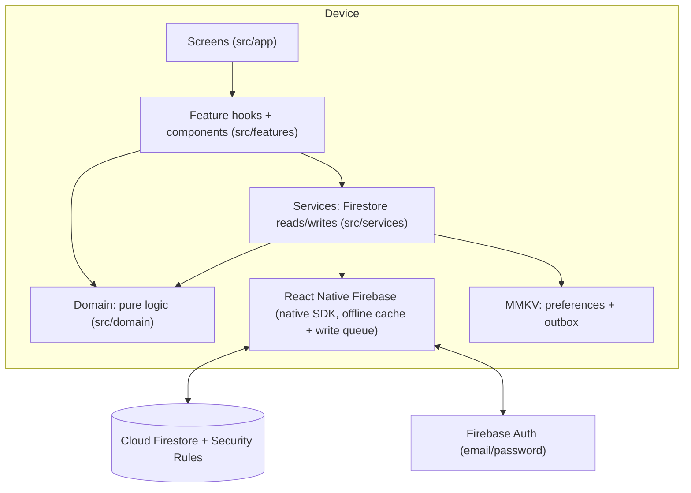

# Architecture

Expo (development builds) + React Native Firebase on the Firebase **Spark** plan. The phone talks directly to Firestore; Security Rules are the only backend logic. No Cloud Functions, Cloud Storage, Admin SDK or second backend.

## Layers

| Folder | Role | Rules |
|---|---|---|
| `src/app` | Expo Router screens | Compose UI only. No Firestore calls. |
| `src/features/*` | Hooks (`useBeneficiaryList`, `useSessions`, …) and feature components | Listeners and pagination live here; writes go through services. |
| `src/services/*` | Firestore refs, batches, online-only operations, files/share | The only place that builds batches. Offline writes use `commitInBackground`; online-only flows use `requireOnline()` + `commitOnline`. |
| `src/domain/*` | Types, zod schemas, phone/search/maps/session/import/export logic | Pure TypeScript, no React or Firebase runtime imports. Unit tested. |
| `src/providers` | Auth and active workspace context, `useCan()` | Workspace switching uses `pickActiveWorkspace()`. |
| `src/components` | Design system (`ui/`) and layout (`AppHeader`, `SyncPill`) | Theme tokens from `src/constants/theme.ts`. RTL via logical styles (`start`/`end`). |
| `firestore.rules` | Authorization and data shape | Mirrors `src/services/permissions/matrix.ts`; tested on the emulator. |

## Dependencies and why

| Package | Why |
|---|---|
| `expo`, `expo-router`, `expo-dev-client`, `expo-build-properties` | App shell, file-based routes, dev builds (React Native Firebase needs native code, so no Expo Go) |
| `@react-native-firebase/app`, `auth`, `firestore` | Native SDKs: real offline persistence and write queue, which the web SDK lacks on React Native |
| `react-native-mmkv` (+ `react-native-nitro-modules`) | Fast synchronous storage for preferences (zustand persist) and the outbox |
| `zustand` | Small stores: preferences, sync status |
| `@react-native-community/netinfo` | Connectivity for the sync pill and `requireOnline()` |
| `i18next`, `react-i18next`, `expo-localization` | Arabic (default, RTL) and English, Arabic plural rules |
| `@expo-google-fonts/ibm-plex-sans-arabic`, `expo-font`, `expo-asset` | Arabic UI font; `expo-asset` also loads the TTF so PDFs embed it |
| `zod`, `react-hook-form`, `@hookform/resolvers` | One schema per form, shared by create, edit and import validation |
| `libphonenumber-js` (`/max` metadata) | Egyptian phone validation and E.164; the "min" metadata accepted invalid numbers |
| `@shopify/flash-list` | Long beneficiary lists |
| `lucide-react-native`, `react-native-svg` | Icons |
| `expo-crypto` | Invite codes (`getRandomBytes`) and phone/pin ids (`randomUUID`) |
| `expo-location` | "Use my current location" for pins (permission asked only then) |
| `expo-linking` | Deep links `bemyhand://join`, `tel:`, Maps |
| `expo-document-picker`, `expo-file-system` | Pick import files; write export files to cache |
| `xlsx` (SheetJS 0.20.3) | Read xlsx/csv, write xlsx, on device |
| `expo-print`, `expo-sharing` | HTML → PDF on device; system share sheet |
| `react-native-reanimated`, `react-native-gesture-handler`, `react-native-screens`, `react-native-safe-area-context`, `react-native-worklets` | Navigation and gesture runtime required by Expo Router |
| `@react-native-async-storage/async-storage` | Required by React Native Firebase Auth persistence |
| Dev: `vitest`, `@firebase/rules-unit-testing`, `firebase`, `firebase-tools` | Unit tests and rules tests on the Firestore emulator |

## Data access patterns

- **Listeners** (`onSnapshot`): only for small or first-page data. Membership list, the active workspace doc, cities and areas (tens of docs), the first page (20) of lists, one session doc + its ≤100 items, the 5 most recent activity events.
- **Pages**: next pages use `getDocs` with `startAfter(cursor)`, 20 per page. No listener per page.
- **Search**: `nameSearch` prefix range (normalized Arabic) or exact `phoneDigits array-contains` (E.164). See `src/domain/search.ts`.
- **Counters**: `beneficiaryCount`, `areaCount`, `cityCount`, `sessionCount` and per-area `beneficiaryCount` move with `increment()` in the same batch as the change. Display only; an admin "recount" (`getCountFromServer`) repairs drift.
- **Writes**: batches, never transactions (transactions fail offline). Deterministic ids where retries matter (session item id = beneficiary id, invite code = doc id).

## Read and write budget

Spark free quota: **50,000 reads, 20,000 writes, 20,000 deletes per day**. Estimates below are for one workspace with ~500 beneficiaries, 30 areas, 5 active members.

### Reads

| Action | Reads | Notes |
|---|---|---|
| App open (memberships + workspace + cities + areas) | ~1 + 1 + 5 + 30 ≈ 40 | Cached afterwards; listeners only re-read changed docs |
| Beneficiary list, first page | 20 | Live listener: every change to one of those 20 docs costs 1 read per open listener |
| Each "load more" | 20 | `getDocs`, no listener |
| Search (name or phone) | ≤ 20 | One query per debounced input (300 ms) |
| Beneficiary details | 1 + history page (20) + assistance (≤ 20) | History only with `history_view` |
| Home recent activity | 5 | Collection-group listener, limit 5 |
| Session setup "check count" | ≤ 101 | `limit(max + 1)` across area chunks of 30 |
| Session runner | 1 + ≤ 100 | Session doc + items listener. Each Check/Ignore re-reads 1 item + the session doc on every device listening |
| Runner prefetch of beneficiary docs | ≤ 100, once per session per app run | Only for users with `beneficiaries_view`, only online; makes "View details" work offline |
| Members screen | members + pending invites | Tens |
| Audit / history pages | 20 per page | |
| Export, beneficiary list | ≤ 500 | One `getDocs` (cache when offline) |
| Import preview | ~500 + cities + areas | Server read for exact duplicate detection |
| Rename city/area | beneficiaries in that city/area | Fan-out update needs the ids |
| Recount | ~1 per 1000 counted docs per aggregation, ~35 aggregations | Plus area docs |

**Listener pagination cost:** the first page is a listener so edits show up live. While the list screen is open, every write to one of those 20 documents costs one read per device that has the list open. That stays small at this scale. Later pages are one-time reads; they are dropped and re-read (20 at a time, only if the user scrolls again) whenever the first page changes or the filter changes, so they never go stale for long.

**Typical day** (3 operators, 2 sessions of 100, 50 edits, a few searches and exports): about 2,000–5,000 reads.

### Writes

| Action | Writes |
|---|---|
| Create beneficiary | 4 (doc, workspace counter, area counter, history) |
| Edit beneficiary | 1 + 1 history per change type (+2 if the area changes) |
| Archive / restore | 4 |
| Pin add/edit/remove, call attempt | 2 / 1 |
| Assistance record (confirmed) | 3 (record, beneficiary, history) |
| Start session (N items) | N + 4 (session, items, counter, 2 events) ≤ 104 |
| Check / Ignore / Reopen | 3–4 (item, session counter, session event, optional history) |
| End session | 2 |
| Import (N rows) | ~2N + counters per batch |
| Rename city/area | 1 + number of affected beneficiaries (+ areas for a city) |
| Workspace create / invite / join | 2 / 2 / 3 + audit |

**Typical day:** two 100-item sessions ≈ 2 × (104 + 100 × 4 + 2) ≈ 1,000 writes; plus edits and logging ≈ a few hundred. Well under 20,000.

### What would break the budget

- Opening many devices on a large unfiltered list for hours while someone bulk-edits (listener re-reads).
- Repeated import previews or full exports of very large workspaces (each reads every beneficiary).
- Renaming a city with thousands of beneficiaries (one write each).

The design keeps those rare and explicit (online-only, behind permissions, with confirmation).

## Indexes

Composite indexes are in `firestore.indexes.json`: beneficiaries by `isArchived` + `nameSearch` (and per area / city), `isArchived` + `phoneDigits`, sessions by `operatorId`/`status` + `createdAt`, areas by `cityId` + `nameSearch`, collection-group `history` by `workspaceId` + `createdAt`, and a collection-group field override for `members.userId`. Deploy with `pnpm deploy:rules`.

## Known limitations

See [[offline-sync#Known limitations]] and [[open-product-decisions]].
