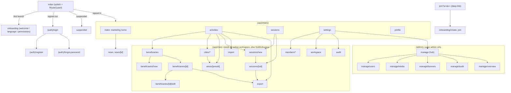

# Product flows

Arabic is the default language (RTL); English is available in Settings. Every flow below names the screen file under `src/app`, whether it needs a connection, and the permission that gates it (see [[security]]).

## Screen map

## Account

| Flow | Screen | Connection | Notes |
|---|---|---|---|
| Register | `(auth)/register` | required | Email + password + display name. Creates `users/{uid}`. |
| Login / logout | `(auth)/login`, More | required for first login | Session persists across restarts. |
| Forgot password | `(auth)/forgot-password` | queued if offline | Offline requests go to the outbox and are sent on reconnect ("we'll send the email when you're back online"). |

## Workspaces

| Flow | Screen | Connection | Permission |
|---|---|---|---|
| Create workspace | `onboarding/create` | required | any signed-in user (becomes owner) |
| Join by invite | `join` (deep link `bemyhand://join?w=…&c=…`, or paste the link/code from onboarding) | required | holder of a valid, unused, unexpired invite |
| Switch workspace | More → workspace switcher | works offline for cached memberships | member |
| Edit name/description, recount counters | `workspace` | required for recount | owner/admin |
| Invite | `members/invite` | required | `members_manage` |
| Edit member role/permissions, disable, remove | `members/[memberId]` | required | `members_manage`; nobody edits their own grants; the owner is untouchable |
| Leave workspace | More | required | any non-owner |
| Transfer ownership | `members/[memberId]` | required | owner |
| Audit log | `audit` | cached pages offline | owner/admin or `members_manage` |

The app remembers the last workspace on the device and on the user profile, so a new device opens the same workspace.

## Places

| Flow | Screen | Connection | Permission |
|---|---|---|---|
| Add / archive city | `cities/index` | offline OK | `areas_manage` |
| Add / deactivate area, edit description | `cities/[cityId]`, `areas/[areaId]` | offline OK | `areas_manage` |
| Rename city / area | same | required (rewrites names on beneficiaries) | `areas_manage` + `beneficiaries_edit` |

## Beneficiaries

| Flow | Screen | Connection | Permission |
|---|---|---|---|
| List, filter by city/area, search | `(tabs)/beneficiaries`, `areas/[areaId]` | offline shows cached data | `beneficiaries_view` |
| Add (global, or from an area with the area preselected) | `beneficiaries/new` | offline OK | `beneficiaries_create` |
| Edit | `beneficiaries/[id]/edit` | offline OK | `beneficiaries_edit` |
| Archive / restore | details | offline OK | `beneficiaries_archive` |
| Phones (up to 10, one primary) | form | offline OK | create/edit |
| Duplicate warning (same phone) | form | uses cache offline | create/edit |
| Pins (up to 10): paste a Maps link or `lat,lng`, or use current location | details | offline OK (short links need a connection to expand) | `beneficiaries_edit` |
| Open pin in Google Maps | details, runner | needs Maps app/browser | view |
| Call | details, runner | phone line | view; logs `call_initiated` (an attempt, never "answered") |
| Assistance: record, confirm | details | offline OK | `assistance_record` |
| History | details | cached pages offline | `history_view` |

Search: names use a normalized Arabic prefix (hamza, taa marbuta, alef maqsura and diacritics ignored); phone numbers are matched exactly after normalization (`010…`, `+20…`, `0020…`, Arabic digits).

## Distribution sessions

See [[session-workflow]] for the full state machine.

1. **Setup** (`sessions/new`, online, `sessions_create`): stepper. Details (name defaults to "Distribution + date", one city), Areas (area cards with an estimated count against the 100 cap), Review (**Check count** on live data, blocked above 100, then **Start**).
2. **Runner** (`sessions/[sid]`, offline OK, operator or `sessions_reassign`): field mode: progress strip, current item with phones, pickup, address, notes and pins; **تم (Check)** / **Ignore** as large thumb-zone buttons with haptics, advancing immediately; list and ignored tabs; reopen ignored; note; call; view details.
3. **End**: confirm; pending items stay "not processed".
4. **Report**: export the session (xlsx / PDF / CSV).
5. **Reassign** (`sessions_reassign`, online): pick another active member.

"Check" means the operator processed the name in this session. It is **not** proof of delivery and never creates an assistance record.

## Import and export

See [[import-export]].

- **Import** (`import`, online, `beneficiaries_import`): pick xlsx/csv → map columns → preview (new / existing / duplicates in file / invalid, missing places) → choose skip or update for existing → run → summary.
- **Export** (`export`, offline OK, `beneficiaries_export`): beneficiary list (all, a city or an area; archived optional), one beneficiary profile, or a session report; xlsx, PDF or CSV; shared through the system share sheet.

## Home and Activities

- **Home** (`(tabs)/index`): greeting, marketing banners carousel (Cloudinary images, gradient fallback), CTA card, platform stats or tips, quick actions, latest news. Content comes from `banners`, `news`, `marketingCards`, `platformStats` (seeded by `scripts/seed-marketing.mts`). Works with no workspace.
- **Activities** (`(tabs)/activities`): workspace title (tap to switch), counters, resume my active session or start one, tile actions (add beneficiary, all beneficiaries, areas, import, export; each shown only with its permission), areas with counts, and the most recent activity events.

## Sync indicator

The pill in every header shows offline, syncing / N waiting, all synced, or sync problem. Tapping it opens the sync sheet with failures (Retry / Dismiss) and outbox jobs. See [[offline-sync]].

## Screen states

Every list and form screen handles the states below. "Skeleton" appears only after a short delay (`useDelayedLoading`) so fast cache hits do not flash. Paged lists use `usePaginatedQuery`; members, invites, cities and areas are small bounded sets (tens) shown in a fixed order, so each is one live listener instead (a deliberate deviation: paging would break role/name ordering and offline completeness).

### Beneficiary list (`beneficiaries`, `areas/[areaId]`)

| State | What the user sees |
|---|---|
| No workspace | `NoWorkspace` (create / join) from the `(ws)` gate |
| No permission (`beneficiaries_view`) | `NoPermissionState` |
| Loading first page | Skeleton rows |
| Error on first page | `ErrorState` with Retry (re-runs the query) |
| Empty | `EmptyState` with "Add beneficiary" when the user can create |
| Filtered empty (search, city/area, archived) | `EmptyState` "No results" |
| Invalid phone search | Warning banner; no query is sent |
| Offline / served from cache | Offline banner above the list; data still shown |
| Loading more | Footer spinner |
| Next page failed | Footer "Couldn't load more" with Retry |
| End of list | Footer end marker |
| Pull to refresh | Native refresh control |

### Beneficiary details (`beneficiaries/[id]`)

| State | What the user sees |
|---|---|
| Loading | Centered spinner |
| Not found / deleted | `EmptyState` |
| Cached data | Offline banner "may be outdated" |
| History loading / failed / empty | Skeleton row / danger banner with Retry / "No activity yet" |
| History more pages | "Load more" button (spinner while loading; Retry banner on failure) |
| Assistance failed to load | Danger banner |
| Archive / restore, delete pin | Confirmation sheet |

### Beneficiary form (`beneficiaries/new`, `beneficiaries/[id]/edit`)

| State | What the user sees |
|---|---|
| No permission | `NoPermissionState` |
| Places loading | Spinner |
| No cities yet (new) | `EmptyState` linking to Cities |
| Field errors | Inline under each field (zod) |
| Saving | Sticky save bar shows a spinner and is disabled |
| Duplicate phone | Confirmation before saving |
| Offline | Saves to the local cache; the sync pill shows it as waiting |

### Cities and areas (`cities`, `cities/[cityId]`, `areas/[areaId]`)

| State | What the user sees |
|---|---|
| Loading | Skeleton (list) or spinner (detail) |
| Error | `ErrorState` with Retry (re-subscribes) |
| Empty | `EmptyState` with "Add city" / "Add area" when the user can manage |
| Not found | `EmptyState` |
| Rename offline | Error toast (rename needs a connection) |
| Archive | Confirmation sheet (city) or menu row (area) |

### Members and invites (`members`, `members/[memberId]`, `members/invite`)

| State | What the user sees |
|---|---|
| Loading | Skeleton |
| Error | `ErrorState` with Retry |
| Empty | `EmptyState` |
| Self / owner | Info banner; nothing editable |
| Permissions | Summary row ("6 of 15 allowed") opening a sheet of switches; admins show "Full access" |
| Saving | Sticky save bar with spinner |
| Remove / transfer / revoke | Confirmation sheet |
| Invite: no permission | `NoPermissionState` |
| Invite: offline or failed | Danger banner |

### Audit log (`audit`)

| State | What the user sees |
|---|---|
| Loading | Skeleton |
| Error | `ErrorState` with Retry |
| Empty | `EmptyState` |
| Paging | Infinite scroll with footer spinner, Retry, end marker |

### Import (`import`)

| State | What the user sees |
|---|---|
| No permission | `NoPermissionState` |
| Offline | Offline banner; Next and Start are disabled |
| Step indicator | "Step n of 3" with a progress bar |
| Unreadable, empty or too large file | Danger banner on the file step |
| Required fields unmapped | Warning banner; Next disabled |
| Row problems | Per-row list with the row number pill (first 30, then "and N more") |
| Missing places | List plus "Create missing" chip, or a warning without `areas_manage` |
| Running | Progress bar with done / total |
| Partial failure | Danger banner: safe to re-import the rest |

### Export (`export`)

| State | What the user sees |
|---|---|
| No permission | `NoPermissionState` |
| Nothing to export | Danger banner |
| Served from cache | Offline-toned banner with the row count |
| Share unavailable | Danger banner |

### Sessions (`(tabs)/sessions`, `sessions/new`, `sessions/[sid]`)

| State | What the user sees |
|---|---|
| No permission (no run, history or create) | `NoPermissionState` |
| Loading history | Skeleton |
| History failed | `ErrorState` with Retry |
| No sessions | `EmptyState` with "Start session" when allowed |
| Cached history | Offline banner |
| Setup offline | Offline banner; Check and Start disabled |
| Setup: no cities / no areas in city | `EmptyState` linking to Cities |
| Setup: estimate above cap | Red meter with the split hint |
| Setup: count none / too many | Warning / danger banner; Start hidden |
| Runner loading / missing / items failed | Spinner / `EmptyState` / `ErrorState` with Retry |
| Not the operator | Warning banner; actions hidden |
| Ended | Info banner, read only |
| All processed | Completion card with End and Export |

## Support, Settings, Profile, About

- **Support** (`support`): reads `appConfig/support` live. InstaPay QR code (encodes `instapayLink`), an Open InstaPay button and the InstaPay address with Copy. These show only when `isEnabled` is true and at least one real identifier exists. Seed placeholders (`REPLACE_…`) and non-https links count as missing (`supportView` in `src/domain/marketing.ts`). The developer website row shows whenever a valid https URL is configured. Nothing payment-related is in the source.
- **Settings** (`(tabs)/settings`): the super admin Manage card first, then the current workspace (role tag, members, cities, history, import, export, audit, workspace settings, leave with confirmation), workspaces (switch, create, join), appearance (lime switches: Match system theme and Dark mode, plus the language row), help (Support, About), and Sign out. Sign out checks for unsynced writes and asks before discarding them.
- **Profile** (`(tabs)/profile`): avatar, name with edit (writes `displayName`, which the rules allow for the user's own profile), contact, super admin tag, the user's workspaces with the current one tagged, preference links, and Sign out.
- **About** (`about`): brand mark, version (and build when set), the data-privacy note, Support, and the developer website from `appConfig/support`.

### Support (`support`)

| State | What the user sees |
|---|---|
| Loading | Skeleton cards |
| Error | `ErrorState` with Retry |
| Disabled or only placeholders | Hero message + "Donations are not open yet" |
| Link configured | QR code, Open InstaPay |
| Address configured | Address with Copy (toast on copy) |
| Link fails to open | Error toast |
| Developer site invalid or missing | Row hidden |
