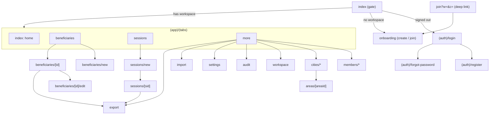

# Product flows

Arabic is the default language (RTL); English is available in Settings. Every flow below names the screen file under `src/app`, whether it needs a connection, and the permission that gates it (see [[security]]).

## Screen map

## Account

| Flow | Screen | Connection | Notes |
|---|---|---|---|
| Register | `(auth)/register` | required | Email + password + display name. Creates `users/{uid}`. |
| Login / logout | `(auth)/login`, More | required for first login | Session persists across restarts. |
| Forgot password | `(auth)/forgot-password` | queued if offline | Offline requests go to the outbox and are sent on reconnect ("we'll send the email when you're back online"). |

## Workspaces

| Flow | Screen | Connection | Permission |
|---|---|---|---|
| Create workspace | `onboarding/create` | required | any signed-in user (becomes owner) |
| Join by invite | `join` (deep link `bemyhand://join?w=…&c=…`, or paste the link/code from onboarding) | required | holder of a valid, unused, unexpired invite |
| Switch workspace | More → workspace switcher | works offline for cached memberships | member |
| Edit name/description, recount counters | `workspace` | required for recount | owner/admin |
| Invite | `members/invite` | required | `members_manage` |
| Edit member role/permissions, disable, remove | `members/[memberId]` | required | `members_manage`; nobody edits their own grants; the owner is untouchable |
| Leave workspace | More | required | any non-owner |
| Transfer ownership | `members/[memberId]` | required | owner |
| Audit log | `audit` | cached pages offline | owner/admin or `members_manage` |

The app remembers the last workspace on the device and on the user profile, so a new device opens the same workspace.

## Places

| Flow | Screen | Connection | Permission |
|---|---|---|---|
| Add / archive city | `cities/index` | offline OK | `areas_manage` |
| Add / deactivate area, edit description | `cities/[cityId]`, `areas/[areaId]` | offline OK | `areas_manage` |
| Rename city / area | same | required (rewrites names on beneficiaries) | `areas_manage` + `beneficiaries_edit` |

## Beneficiaries

| Flow | Screen | Connection | Permission |
|---|---|---|---|
| List, filter by city/area, search | `(tabs)/beneficiaries`, `areas/[areaId]` | offline shows cached data | `beneficiaries_view` |
| Add (global, or from an area with the area preselected) | `beneficiaries/new` | offline OK | `beneficiaries_create` |
| Edit | `beneficiaries/[id]/edit` | offline OK | `beneficiaries_edit` |
| Archive / restore | details | offline OK | `beneficiaries_archive` |
| Phones (up to 10, one primary) | form | offline OK | create/edit |
| Duplicate warning (same phone) | form | uses cache offline | create/edit |
| Pins (up to 10): paste a Maps link or `lat,lng`, or use current location | details | offline OK (short links need a connection to expand) | `beneficiaries_edit` |
| Open pin in Google Maps | details, runner | needs Maps app/browser | view |
| Call | details, runner | phone line | view; logs `call_initiated` (an attempt, never "answered") |
| Assistance: record, confirm | details | offline OK | `assistance_record` |
| History | details | cached pages offline | `history_view` |

Search: names use a normalized Arabic prefix (hamza, taa marbuta, alef maqsura and diacritics ignored); phone numbers are matched exactly after normalization (`010…`, `+20…`, `0020…`, Arabic digits).

## Distribution sessions

See [[session-workflow]] for the full state machine.

1. **Setup** (`sessions/new`, online, `sessions_create`): name (defaults to "Distribution + date"), one city, one or more areas, **Check count** (blocked above 100), **Start**.
2. **Runner** (`sessions/[sid]`, offline OK, operator or `sessions_reassign`): current item with phones, pickup, address, notes and pins; **تم (Check)** / **Ignore** advance immediately; list and ignored tabs; reopen ignored; note; call; view details.
3. **End**: confirm; pending items stay "not processed".
4. **Report**: export the session (xlsx / PDF / CSV).
5. **Reassign** (`sessions_reassign`, online): pick another active member.

"Check" means the operator processed the name in this session. It is **not** proof of delivery and never creates an assistance record.

## Import and export

See [[import-export]].

- **Import** (`import`, online, `beneficiaries_import`): pick xlsx/csv → map columns → preview (new / existing / duplicates in file / invalid, missing places) → choose skip or update for existing → run → summary.
- **Export** (`export`, offline OK, `beneficiaries_export`): beneficiary list (all, a city or an area; archived optional), one beneficiary profile, or a session report; xlsx, PDF or CSV; shared through the system share sheet.

## Home

`(tabs)/index`: workspace counters (beneficiaries, areas, cities, sessions), resume my active session or start a new one, quick actions (add beneficiary, all beneficiaries, import, export; each shown only with its permission), areas with counts, and the 5 most recent activity events.

## Sync indicator

The pill in every header shows offline, syncing / N waiting, all synced, or sync problem. Tapping it opens the sync sheet with failures (Retry / Dismiss) and outbox jobs. See [[offline-sync]].
