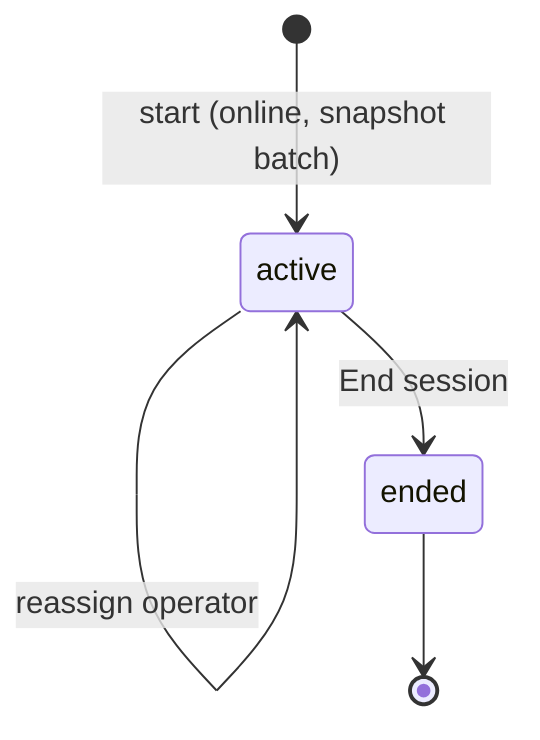

# Session workflow

A distribution session is one field activity, worked by **one operator**.

## Start (online only)

1. Home, **Start session**.
2. Pick one city.
3. Pick areas of that city (select all, one, several, deselect).
4. Confirm. The app:
   - checks connectivity (blocks with "connect to start");
   - queries active, non-archived beneficiaries in those areas with `limit(101)`;
   - blocks if more than **100** ("select fewer areas or split into two sessions");
   - writes, in **one batch**: the session doc (`status: active`, `operatorId = me`), one `items/{beneficiaryId}` per beneficiary, `sessionCount + 1` on the workspace, and `session_created` + `session_started` events. Max 104 writes, well under 500.
   - this one write is awaited (online flow), then navigates to the runner.

Item id = beneficiary id, so duplicates are impossible and a retried batch is idempotent.

## Runner (offline-capable)

Shows one item at a time in stable `order` (name order at start): name, primary phone, other phones (LTR), household size, area, pickup location, notes, pins.

Actions: **Call**, **Open in Google Maps** (per pin), **View details**, **تم (Check)**, **Ignore**.

Check / Ignore are one batch, committed with `commitInBackground()`, never awaited:
- item: `status`, `processedAt: serverTimestamp()`, `processedBy`, `processedClientAt`
- session: `checkedCount` or `ignoredCount` `increment(1)`, `lastProcessedAt`
- session event: `checked` / `ignored`
- beneficiary history: `session_checked` / `session_ignored`

The screen advances to the next pending item immediately from the local snapshot. A per-item lock plus button debounce prevents double processing; rules also only allow `pending → checked|ignored`.

**Reopen**: an ignored item can go back to `pending` (logged as `reopened`, counter `-1`). Ignored items are not revisited automatically.

**Call** logs `call_initiated` (session event + beneficiary history, `contactActionsCount + 1`). It never claims the call connected.

**Check never creates an assistance record and never changes `lastConfirmedAssistanceAt`.** Those are separate concepts (see [[firestore-schema]]).

## End

Confirm, then one batch: `status: ended`, `endedAt`, `endedBy`, final counters recounted from the items in cache (≤100), `pendingCount`, `session_ended` event. Items still pending stay `pending` ("not processed"). Ended sessions are immutable and never deleted. The end screen offers the session report export.

## Reassign

A user with `sessions_reassign` picks another active member. The session's `operatorId` changes and an `operator_reassigned` event is written. The new operator resumes where processing stopped. Only one active session per operator is recommended; starting a second shows a warning but does not block.

## Resume

Sessions survive restarts: state lives in Firestore and its cache. Opening an active session as its operator lands on the first pending item.
